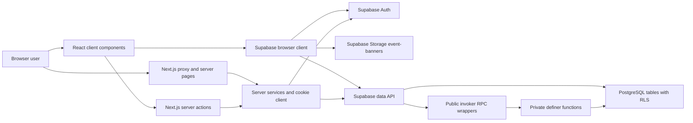
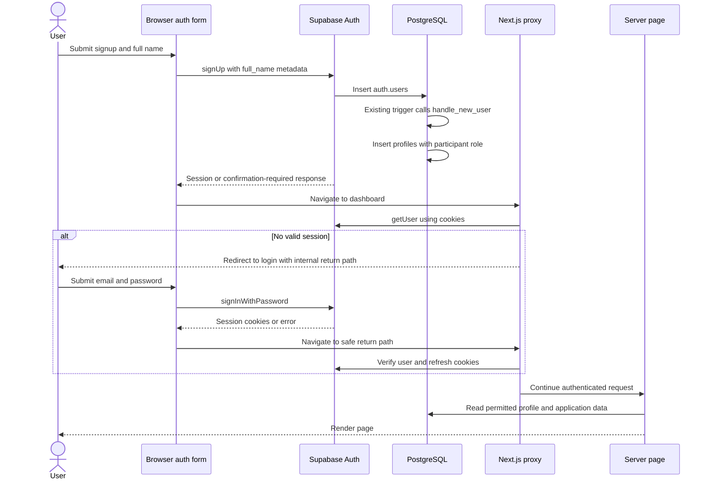
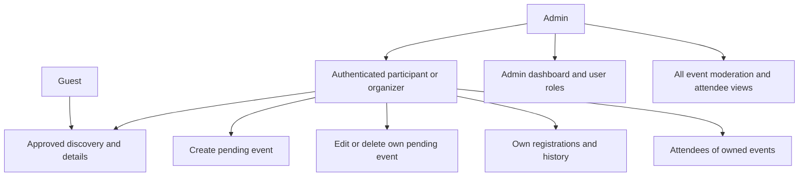
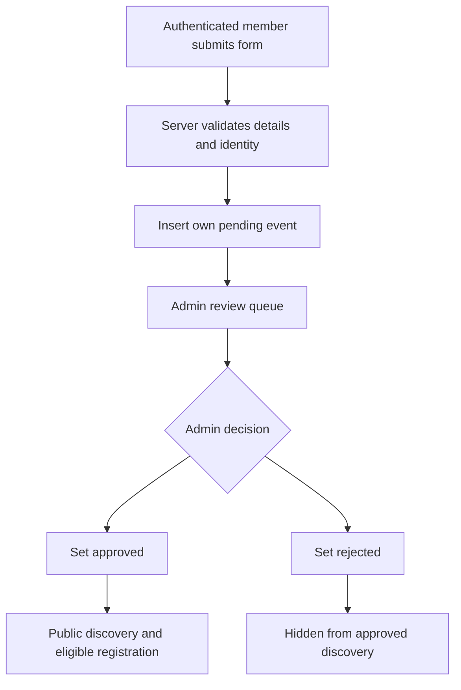
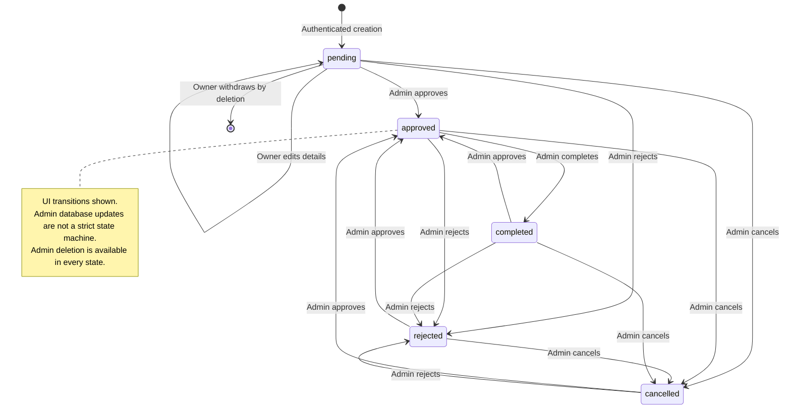
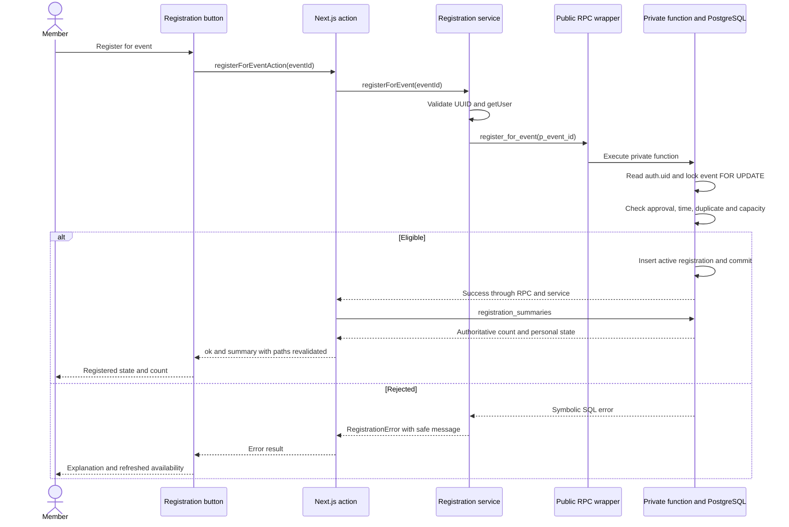
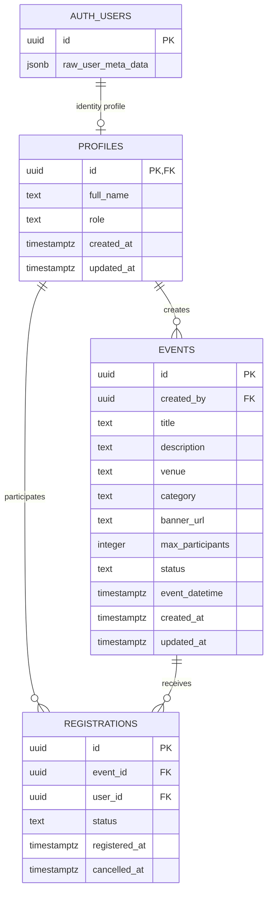

# ORVIO ? Architecture and Workflow Diagrams

Audit: **20 October 2026**, repository **955f1af**. These editable Mermaid blocks match the diagrams in the [complete handbook](ORVIO_COMPLETE_HANDBOOK.md). All source paths are relative to the project root.

The configured Supabase project was not available through the connector, so SQL diagrams describe repository definitions, not freshly verified deployed objects. Safe Node checks passed 190 tests and lint; type checking/build failed on missing local Playwright dependency. See the [implementation audit](ORVIO_IMPLEMENTATION_STATUS.md).

## 1. High-level system architecture

Current Next.js/Supabase communication paths. The browser header also reads its own profile role. FastAPI is not integrated; production hosting is unverified.

Evidence: `frontend/lib/services/server/events.ts`; `frontend/lib/supabase/`; `frontend/lib/actions/`; `frontend/lib/services/banners.ts`.

## 2. Authentication sequence

Repository-defined signup trigger and login/cookie flow. The trigger attachment is modeled by the disposable baseline and assumed by upgrades; hosted confirmation settings and trigger attachment were not freshly inspected.

Evidence: `frontend/components/auth/`; `frontend/lib/supabase/middleware.ts`; `supabase/tests/baseline.sql`; `supabase/migrations/20261011054251_complete_event_registrations.sql`.

## 3. Role-based access overview

Participant and organizer share the authenticated-member paths. Ownership governs pending editing/withdrawal and attendee management. Admin adds platform authority but not arbitrary direct registration writes.

Evidence: `frontend/lib/services/server/events.ts`; `frontend/lib/services/server/admin.ts`; `frontend/lib/auth-routing.ts`; `supabase/tests/baseline.sql`.

## 4. Event approval workflow

Normal creation inserts pending; admin review approves or rejects. Pending withdrawal is hard deletion. This diagram is the review story, not a universal admin state-transition restriction.

Evidence: `frontend/components/events/CreateEventForm.tsx`; `frontend/components/admin/AdminEventActions.tsx`; `frontend/lib/actions/events.ts`; `frontend/lib/services/server/events.ts`.

## 5. Event lifecycle state diagram

UI-exposed transitions are shown. Admin database/service updates are not constrained to this graph; allowed status values can be assigned without a source-state check, including pending through a crafted permitted call. Admin deletion is available in every state, and no automatic completion scheduler exists.

Evidence: `frontend/components/admin/AdminEventManageActions.tsx`; `frontend/lib/services/server/events.ts`; `supabase/tests/baseline.sql`.

## 6. Registration sequence

Server validates UUID/Auth; SQL derives identity and serializes supported registrations with an event-row lock. The post-write summary is a separate request, so summary failure does not roll back an already-committed registration. Actual SQL concurrency was not rerun in this audit.

Evidence: `frontend/components/events/RegisterEventButton.tsx`; `frontend/lib/actions/registrations.ts`; `frontend/lib/services/server/registrations.ts`; `supabase/migrations/20261011054251_complete_event_registrations.sql`.

## 7. Database ER diagram

Repository model reconstructed from the disposable test baseline plus three upgrades. auth.users is shown only with fields used by this model, not its entire managed schema. Auth/profile key constraints permit zero or one profile, while the trigger intends one. Banner URLs are not foreign keys to Storage objects.

Evidence: `supabase/tests/baseline.sql`; `supabase/migrations/20261011054251_complete_event_registrations.sql`; `supabase/migrations/20261014122006_add_event_categories_and_banners.sql`.

