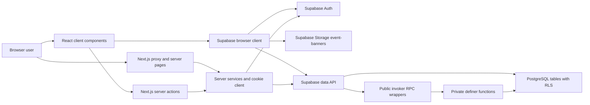
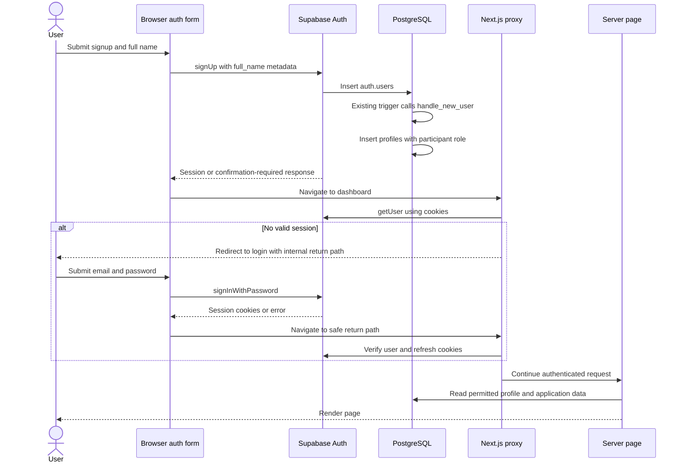
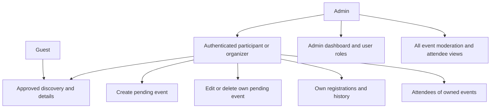
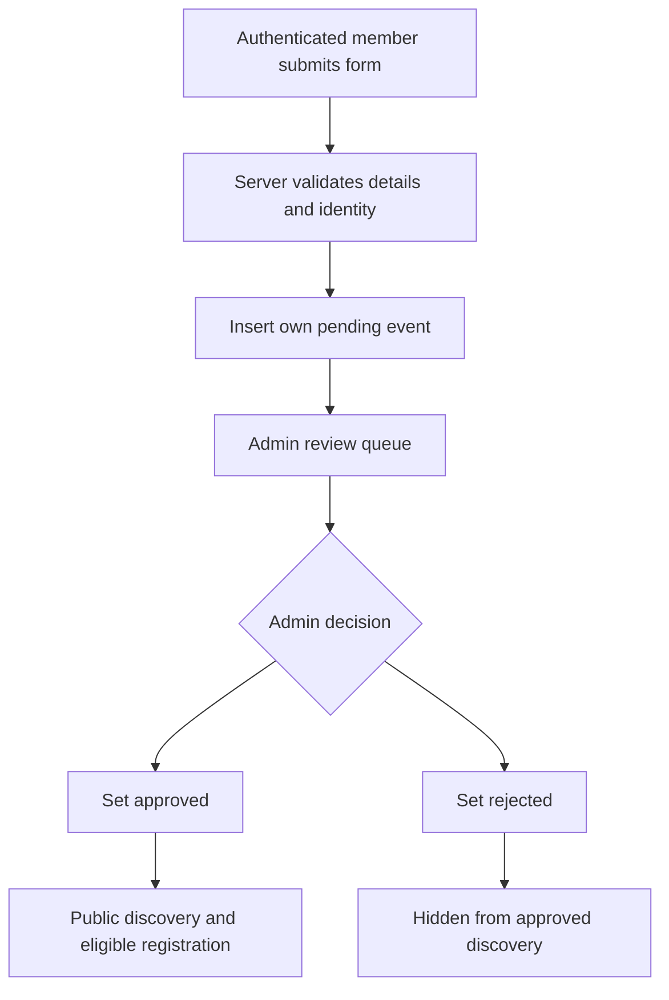
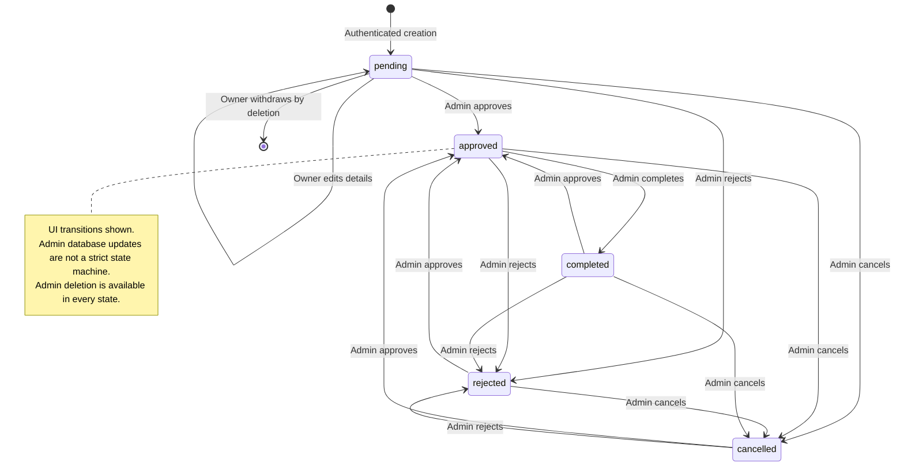
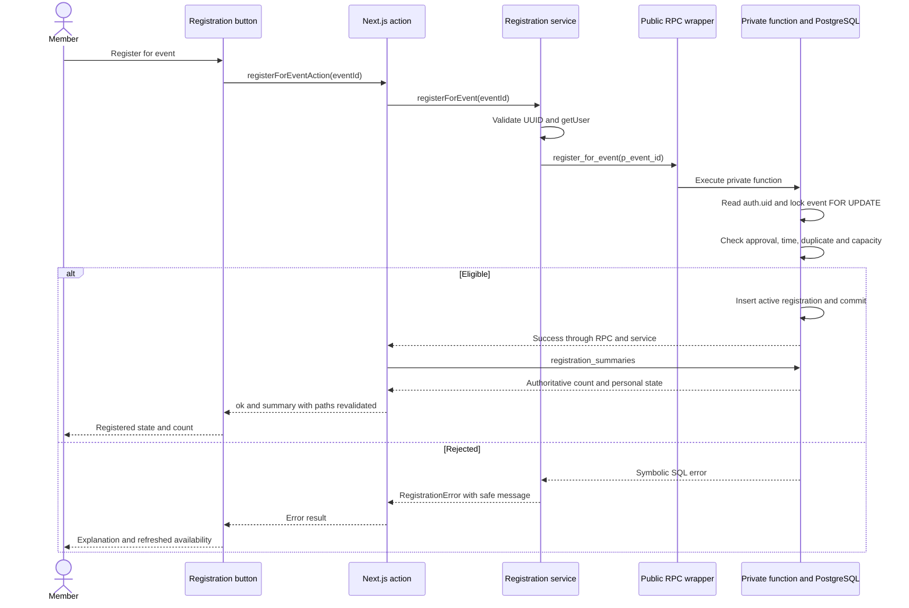
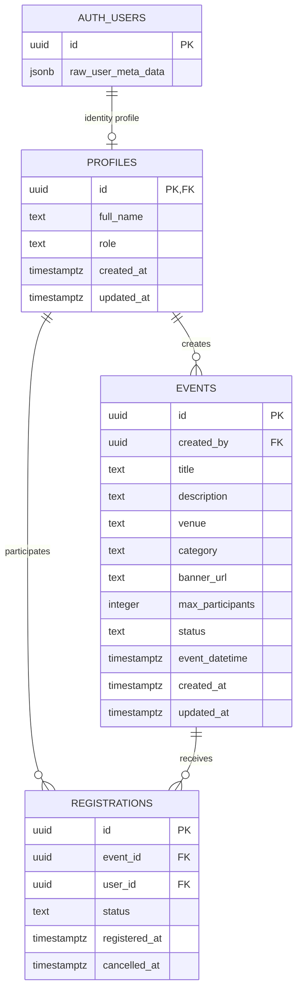

# ORVIO — Complete Project Documentation, Architecture & Technical Explanation

Audit date: **20 October 2026**. Repository baseline: **955f1af**. Project root in this workspace: `C:\Users\ivang\Orvio\Orvio`.

This handbook is a code-based learning guide, architecture reference, and presentation companion. Paths below are relative to that project root. The application was not changed for this audit.

## How to read the evidence

- **Implemented and verified** means a specific behavior was inspected and exercised by the safe checks run during this audit. For services, verification uses stubs; it does not prove a hosted database behaves correctly.
- **Implemented but not verified** means code or SQL exists, but its complete runtime behavior was not exercised during this audit.
- **Partially implemented** means only part of the advertised workflow exists.
- **Not implemented** means no implementation was found in the audited application and SQL. Planning documents are not implementation evidence.

The Node test suite passed **190/190**, ESLint passed, and standalone TypeScript checking and the production build failed because the local install cannot resolve `@playwright/test`. Browser, mutation, and PostgreSQL suites were not rerun. Details appear in Chapter 17.

**Database evidence boundary:** the Supabase connector was available, but its project inventory did not include the project configured in `frontend/.env.local`. Only the configured URL's host was compared; keys were not printed. No unrelated project's tables were queried. Consequently, this handbook describes **repository-defined schema**, reconstructed from `supabase/tests/baseline.sql` plus the three upgrades in `supabase/migrations/`, not a newly verified deployed schema. The baseline is explicitly a disposable test model, not a production bootstrap migration. Historical live verification in `docs/REGISTRATIONS.md` is identified as historical evidence.

Companion documents:

- [Quick revision](ORVIO_QUICK_REVISION.md)
- [Presentation guide](ORVIO_PRESENTATION_GUIDE.md)
- [Editable diagrams](ORVIO_ARCHITECTURE_DIAGRAMS.md)
- [Detailed implementation audit](ORVIO_IMPLEMENTATION_STATUS.md)

## Contents

1. Executive summary
2. Complete technology stack
3. System architecture
4. Application folder structure
5. Authentication and user management
6. User roles and permissions
7. Event management system
8. Event registration system
9. Database architecture
10. Supabase Row Level Security
11. Frontend architecture and UI/UX
12. Important functions and code walkthroughs
13. Complete user journeys
14. API and data flow
15. Validation, error handling and security
16. Running the project locally
17. Testing and verification
18. Deployment architecture
19. Known limitations and future scope
20. How to explain ORVIO in a presentation
21. Viva and interview questions
22. Glossary of technical terms

## Chapter 1 — Executive Summary

### What ORVIO does

ORVIO is a web application for discovering events, submitting events for administrator review, and managing event registrations. It brings event information and participant records into one interface, reducing the need to coordinate independent forms, messages, and spreadsheets.

Visitors browse approved events without an account. Signed-in members can submit an event, edit or withdraw their own pending submissions, register for eligible events, cancel before the start, and review registration history. Event creators can inspect their attendees. Administrators review submissions, change event statuses, delete events, and assign account roles.

The intended audiences are participants, event organizers, and platform administrators. An important implementation detail is that **the organizer role is not required to create an event**: creation is available to authenticated members. Ownership determines creator permissions; the `admin` role grants platform-wide authority. Do not present the current product as having an organizer-only publishing gate.

### Problem, solution, and objectives

| Problem | Implemented response | Objective |
| --- | --- | --- |
| Event details scattered across channels | Approved event discovery, search, categories, venue/time/availability filters | Make events easier to find |
| Unreviewed submissions becoming public | New events enter `pending`; administrators approve or reject | Provide moderation |
| Manual registration lists and duplicates | Database registration RPCs and an active-registration unique index | Keep participant records consistent |
| Competing requests for limited seats | Event-row lock, transactional count/check/insert | Enforce capacity through the supported write path |
| Users lose track of cancellations | Retained cancelled rows and personal history | Make changes explainable |
| Unclear authority over event records | Authentication, ownership checks, admin role, RLS, privileges | Restrict reads and writes |

ORVIO goes beyond an event listing site through moderation, participant history, transactional seat allocation, and owner/admin attendee views. It does not yet provide attendance verification, feedback, payments, notifications, or full organizer analytics. Some older documents describe these as goals.

### Current implementation status

Core application paths are implemented, and safe Node checks verify substantial helper and service behavior. Hosted Auth, database, Storage, and browser workflows were not freshly exercised. Production readiness is not established: the current local build is blocked by a missing declared development dependency, a clean production bootstrap schema is absent, and live configuration remains unverified. See the implementation audit for feature-level labels.

### “What is your project about?” — 120 words

ORVIO is a web platform that brings event discovery, event submissions, and participant registrations into one place. Visitors can browse approved events, while signed-in members can submit events for administrator review and manage their own registrations. New events start as pending, and administrators decide whether they become visible in the approved event collection. Registration is handled inside PostgreSQL, where the system checks the event status, start time, duplicate registrations, and remaining capacity before reserving a place. Users can cancel before the event starts, and cancellation history is retained. Event creators and administrators can view attendee records. The application uses Next.js and Supabase, with database permissions and Row Level Security supporting access control. Attendance verification and payments remain future scope for ORVIO.

### 30-second elevator pitch

“ORVIO helps people discover events and manage participation in one place. Members submit events, administrators review them, and participants register for available places. PostgreSQL checks capacity and duplicates inside a transaction, while users can cancel and retain their history. Next.js provides the application, and Supabase supplies authentication, database access, and banner storage.”

## Chapter 2 — Complete Technology Stack

### Actual application and verification stack

Versions are resolved from `frontend/package-lock.json`, not inferred from version ranges. A lockfile records the intended install; it does not guarantee every package exists in the current `node_modules`.

| Technology | Purpose | Where Used | Why Used |
| --- | --- | --- | --- |
| Next.js 16.2.11 | Routing, server rendering, actions, build tooling | `frontend/app/`, `frontend/proxy.ts`, `frontend/lib/actions/` | Keeps page rendering and application server logic together |
| React / React DOM 19.2.4 | Component rendering and interactions | Pages, forms, dialogs, header | Reusable UI and state management |
| TypeScript | Static checking and domain types | `.ts`/`.tsx`, `frontend/tsconfig.json` | Describes event, role, profile, registration shapes |
| Tailwind CSS 4 | Utility styles and design tokens | `frontend/app/globals.css`, component classes, `frontend/postcss.config.mjs` | Shared responsive styling without separate CSS for every component |
| shadcn 3.8.3 and local UI primitives | UI conventions and generated/editable component source | `frontend/components.json`, `frontend/components/ui/`, CSS import | Consistent buttons, inputs, dialogs, cards |
| Base UI 1.6.0 | Interactive primitive behavior | Local dialog, menu and other UI wrappers | Shared interaction patterns without hand-building each primitive |
| `@supabase/ssr` 0.12.3 | Browser/server Supabase clients with cookies | `frontend/lib/supabase/` | Lets server requests use the browser's authenticated session |
| `@supabase/supabase-js` 2.110.8 | Auth, PostgREST, RPC, Storage client | Supabase client factories and services | One SDK for hosted platform services |
| Supabase Auth | Account credentials and sessions | Signup/login/logout, `auth.getUser()` | Delegates identity and password handling |
| PostgreSQL and RLS | Relational data, constraints, transactions, access policies | SQL migrations and Supabase queries | Relationships plus database-enforced business rules |
| Supabase Storage | Public event banner objects | `frontend/lib/services/banners.ts`, metadata migration | Stores image files outside relational rows |
| Zod 4.4.3 | Runtime validation | Event and profile schemas | Checks untrusted values beyond TypeScript |
| React Hook Form 7.83.0 | Event form state and errors | `frontend/components/events/CreateEventForm.tsx` | Coordinates form fields and validation |
| `@hookform/resolvers` 5.5.7 | Connects Zod to React Hook Form | Same form | Reuses schema validation in the form |
| Lucide React 1.26.0 | Icons | Header, landing, event/admin/profile UI | Consistent visual vocabulary |
| Class Variance Authority 0.7.1 | Component variants | `frontend/components/ui/button.tsx` | Centralizes button size/style combinations |
| clsx 2.1.1 and tailwind-merge 3.6.0 | Conditional class composition | `frontend/lib/utils.ts`, UI primitives | Merges class strings and resolves utility conflicts |
| tw-animate-css 1.4.0 and CSS animations | Motion utilities and local entrance/loading motion | Global CSS and UI primitives | Consistent interaction and loading feedback |
| Node.js built-in test runner | Unit, feature and stubbed service tests | `frontend/tests/`, npm scripts | Runs plain JavaScript test modules without another unit-test framework |
| ESLint 9 / eslint-config-next 16.2.11 | Static lint rules | `frontend/eslint.config.mjs` | Checks Next.js/React/TypeScript patterns |
| Playwright Test 1.64.0 | Browser integration/regression framework | `frontend/playwright.config.ts`, `frontend/tests/e2e/` | Exercises navigation and authenticated workflows when dependencies/fixtures are available |
| StrykerJS 9.3.0 | Mutation testing | `frontend/stryker.config.json` | Measures whether selected helper tests detect altered logic |
| Python unittest and psycopg2 | Disposable PostgreSQL integration/concurrency tests | `supabase/tests/test_registrations.py` | Tests actual SQL policies and transactions in isolation |
| Docker | Development frontend container; documented disposable database setup | `frontend/Dockerfile`, `docs/REGISTRATIONS.md` | Reproducible development processes |

**Installed does not mean integrated.** `framer-motion` 12.42.2 and `sonner` 2.0.7 are declared and locked, but no imports were found in application source. Do not claim Framer Motion drives the landing animations or that Sonner provides app notifications. The current motion is visible in CSS. Vercel appears in the starter README and public assets, but a production Vercel deployment was not established.

`backend/requirements.txt` pins FastAPI, Uvicorn, Supabase Python, SQLAlchemy, Alembic, psycopg2, and their dependencies. `backend/app/core/supabase.py` creates a privileged client; `backend/app/main.py` is empty. No FastAPI application, routes, or frontend calls to that backend were found. These packages are scaffolding and test support, not the running application's custom API stack.

### Understanding the main technology choices

The following “why” explanations describe suitability inferred from code structure. The repository does not contain a formal decision record proving each author's original motivation.

**Next.js:** a React application framework that handles URLs, rendering, and server execution. ORVIO needs both interactive forms and authenticated database access. Its pages load data on the server, while actions process mutations. For example, an event page calls `getEventById()` without exposing database credentials beyond the public Supabase client configuration. Advantages include one TypeScript application and shared types; limitations include framework-specific caching, cookie, and action behavior. Alternatives include React with a separate Express/FastAPI API, or another full-stack framework. Those would require a different server integration.

**React and TypeScript:** React builds screens from reusable components; TypeScript describes values during development. ORVIO shares `Event`, `UserRole`, and `RegistrationSummary` types across services and UI. The advantage is clearer component contracts; the limitation is that JavaScript requests still need runtime validation. A browser can send an invalid status despite a TypeScript union. Plain JavaScript is possible but gives up these static checks.

**Tailwind, shadcn, and Base UI:** Tailwind supplies style utilities, shadcn conventions keep component source editable locally, and Base UI provides interaction primitives. ORVIO combines them to reuse dialogs and buttons with black/orange tokens. This reduces duplicated styling while preserving control. The tradeoff is verbose class lists and responsibility for maintaining local wrappers and accessibility. Alternatives include CSS Modules with custom components, Material UI, or another primitive library.

**Supabase:** a hosted platform combining Auth, PostgreSQL APIs, and Storage. ORVIO uses its SDK from both browser and server. This avoids implementing credential storage, file storage APIs, and a separate CRUD server. RLS and RPCs remain essential: the public SDK key is not a secret authorization barrier. Limitations include dependence on hosted configuration and careful management of SQL permissions. Alternatives include a custom API backed by PostgreSQL or another managed backend.

**PostgreSQL:** a relational database with keys, constraints, SQL functions, and transactions. ORVIO needs relationships between profiles, events, and registrations, and a reliable last-seat decision. A transaction locks an event before counting active seats. The advantage is enforcing rules near the data; the limitation is that privileged functions must be carefully reviewed. No application ORM is used: the Supabase query builder and SQL RPCs are the access mechanisms. SQLAlchemy is only a backend dependency here.

**RLS:** row-specific database access rules. ORVIO needs them because a caller can bypass UI buttons and use the Supabase API directly. A policy limits event updates to the creator's pending records; a separate admin policy permits moderation. Advantages are centralized enforcement and protection across API clients. Limitations are policy complexity, inherited baseline assumptions, and the need to combine policies with table/function privileges and triggers.

**Zod and React Hook Form:** Zod checks values at runtime; React Hook Form manages fields and errors. The event form uses a resolver for feedback, and the server parses the same extended schema again. This provides consistent feedback without trusting the browser. Database constraints still protect direct SDK requests. Alternatives include manual validation or another schema/form library; neither eliminates the need for server and SQL checks.

**Testing tools:** Node tests cheaply exercise logic with stubs; Playwright exercises a real browser; Python/PostgreSQL tests exercise actual SQL. Each answers a different question. A mocked RPC success does not prove transaction correctness, and a mutation score for four helpers does not describe the whole app.

## Chapter 3 — System Architecture

### The running application

ORVIO uses **Next.js server functionality plus Supabase**, rather than an integrated separate FastAPI backend. The frontend folder contains both browser UI and server-side application logic. “Frontend” is therefore a directory name, not proof that all its code runs in a browser.



### What each arrow means

| Path | Communication and responsibility |
| --- | --- |
| Browser → proxy/server pages | HTTP navigation; proxy verifies/refreshes sessions and redirects protected requests; pages load permitted data |
| Client components → server actions | Framework-managed action calls carry mutation inputs; actions invoke services and invalidate affected routes |
| Server pages/actions → services | Local TypeScript calls separate rendering/action transport from domain/data logic |
| Server client → Auth | `getUser()` verifies identity against Auth using session cookies |
| Server/browser client → data API | Supabase SDK requests carry the current session; PostgreSQL privileges and RLS govern ordinary queries |
| Browser → Auth | Signup, password login, logout, and session updates use the browser SDK |
| Browser → data API | The shared header reads the signed-in user's profile role; it uses that result for navigation only |
| Browser → Storage | Banner uploads use authenticated account folders; public image URLs are then saved on events |
| Data API → RPC wrappers → private functions | Registration operations enter SQL functions; private implementations enforce identity, visibility, and transactional rules |
| Database → services → page/UI | Query results become typed data, rendered HTML/component props, or action result objects |

No custom `app/api/**/route.ts` handlers were found. Server actions are server entry points, but are not the REST endpoints proposed in `docs/09-API-Design.md`. Supabase's HTTP APIs are external platform APIs, distinct from a custom ORVIO REST API.

### Server and client components

Server pages such as the dashboard and admin page can `await` services before rendering. They do not ship their database-loading code as browser component logic. Client components use `"use client"` to handle state, clicks, router updates, and dialogs. The root layout supplies fonts, global styles, the shared header, and a skip link.

The route group `(protected)` helps organize files but **does not itself enforce security**. Public event pages live inside that group too. Actual protection comes from `protectedPath()` in the proxy, page/service checks, and the database.

### Deployment boundary

The repository supports a Next.js development server and production `build`/`start` scripts connected to Supabase. The Dockerfile runs the development server. No production hosting account, domain, CI deployment, or deployed application revision was verified. A diagram of a Vercel deployment would therefore be a proposal, not a description of an established deployment.

## Chapter 4 — Application Folder Structure

This is a curated source tree; dependencies, generated build files, credentials, and design screenshots are omitted. Every displayed path exists.

```text
Orvio/
├── README.md
├── backend/
│   ├── requirements.txt
│   └── app/
│       ├── main.py                         # empty scaffold
│       └── core/supabase.py                # privileged Python client
├── frontend/
│   ├── package.json
│   ├── package-lock.json
│   ├── next.config.ts
│   ├── proxy.ts
│   ├── Dockerfile
│   ├── components.json
│   ├── tsconfig.json
│   ├── eslint.config.mjs
│   ├── playwright.config.ts
│   ├── stryker.config.json
│   ├── app/
│   │   ├── layout.tsx
│   │   ├── globals.css
│   │   ├── loading.tsx
│   │   ├── (public)/page.tsx
│   │   ├── (auth)/login/page.tsx
│   │   ├── (auth)/signup/page.tsx
│   │   └── (protected)/
│   │       ├── error.tsx
│   │       ├── dashboard/page.tsx
│   │       ├── profile/page.tsx
│   │       ├── registrations/page.tsx
│   │       ├── admin/page.tsx
│   │       └── events/
│   │           ├── page.tsx
│   │           ├── create/page.tsx
│   │           └── [id]/
│   │               ├── page.tsx
│   │               ├── edit/page.tsx
│   │               └── attendees/page.tsx
│   ├── components/
│   │   ├── admin/
│   │   ├── auth/
│   │   ├── dashboard/
│   │   ├── events/
│   │   ├── landing/
│   │   ├── layout/
│   │   ├── profile/
│   │   └── ui/
│   ├── lib/
│   │   ├── actions/
│   │   ├── services/server/
│   │   ├── services/events.ts
│   │   ├── services/banners.ts
│   │   ├── supabase/
│   │   ├── validations/event.ts
│   │   ├── auth-routing.ts
│   │   ├── event-datetime.ts
│   │   ├── event-discovery.ts
│   │   ├── event-metadata.ts
│   │   ├── profile.ts
│   │   ├── registrations.ts
│   │   └── utils.ts
│   ├── public/
│   ├── scripts/
│   └── tests/
│       ├── e2e/
│       ├── features/
│       ├── services/
│       └── support/
├── supabase/
│   ├── migrations/
│   │   ├── 20261011054251_complete_event_registrations.sql
│   │   ├── 20261011054420_harden_existing_role_helper.sql
│   │   └── 20261014122006_add_event_categories_and_banners.sql
│   └── tests/
│       ├── baseline.sql
│       └── test_registrations.py
└── docs/
    ├── REGISTRATIONS.md
    ├── testing/
    ├── registration-review/
    ├── ui-review/
    ├── design/
    └── project-handbook/
```

### Developer navigation guide

| If I want to change… | Start here | Follow through to… |
| --- | --- | --- |
| Public landing copy | `frontend/components/landing/` | `frontend/app/(public)/page.tsx` |
| Brand colors or spacing conventions | `frontend/app/globals.css` | Local `components/ui/` wrappers |
| Shared navigation or admin link visibility | `frontend/components/layout/AppHeader.tsx` | `frontend/lib/supabase/client.ts` |
| Login return destinations | `frontend/app/(auth)/login/page.tsx` | `frontend/lib/registrations.ts`, `frontend/lib/auth-routing.ts` |
| Session refresh/protected paths | `frontend/proxy.ts` | `frontend/lib/supabase/middleware.ts` |
| Signup fields | `frontend/components/auth/SignupForm.tsx` | SQL `handle_new_user()` |
| Event form fields | `frontend/components/events/CreateEventForm.tsx` | `frontend/lib/validations/event.ts`, `frontend/lib/event-metadata.ts` |
| Event create/edit rules | `frontend/lib/services/server/events.ts` | `frontend/lib/actions/events.ts`, SQL policies |
| Categories or allowed banner URLs | `frontend/lib/event-metadata.ts` | Metadata/storage migration |
| Banner upload | `frontend/lib/services/banners.ts` | `frontend/components/events/BannerUpload.tsx` |
| Event date conversion | `frontend/lib/event-datetime.ts` | Event form and timezone feature tests |
| Search/filter/sort behavior | `frontend/lib/event-discovery.ts` | Events page and `getApprovedEvents()` |
| Registration button behavior | `frontend/components/events/RegisterEventButton.tsx` | Registration actions/services/RPCs |
| Capacity and duplicate prevention | Registration migration | `private.register_for_event()`, unique index and capacity trigger |
| Attendee authorization/pagination | `frontend/app/(protected)/events/[id]/attendees/page.tsx` | Registration service and `get_event_attendees()` SQL |
| Admin moderation | `frontend/components/admin/` | Admin page, event/admin actions and services |
| User role changes | `frontend/lib/services/server/admin.ts` | Profile role trigger and policies |
| Display-name editing | `frontend/components/profile/ProfileForm.tsx` | Profile schema, action and server service |
| Test scope and fixtures | `frontend/tests/TESTING.md` | npm scripts, Playwright config, SQL test runner |

No `supabase/config.toml`, production baseline migration, separate types directory, or application API route directory was found. Domain types live beside services/helpers.

## Chapter 5 — Authentication and User Management

### Authentication versus authorization

Authentication answers “Who is making this request?” Supabase Auth verifies an account and issues a session. Authorization answers “What may this identity do?” ORVIO uses profile roles, event ownership, table privileges, SQL functions, and RLS for that second question. Logging in does not make someone an administrator.

### Signup and profile creation

`SignupForm.tsx` collects full name, email, password, and confirmation. It checks matching passwords locally, then calls `supabase.auth.signUp({ email, password, options: { data: { full_name } } })`. It does not submit an administrator or organizer role.

Supabase creates the identity in `auth.users`. The repository's test baseline attaches `on_auth_user_created`, an `AFTER INSERT` trigger, to that table. The registration migration replaces `public.handle_new_user()` so it inserts the new ID, `raw_user_meta_data->>'full_name'`, and the literal role `participant` into `public.profiles`. The migration does not recreate the Auth trigger; it assumes the pre-existing trigger is present. Its attachment in the live project was not inspected during this audit.

`auth.users.id` is the account's UUID. `public.profiles.id` uses the same UUID as both primary key and foreign key. Auth owns credentials and the verified email; profiles own app-facing name and role. ORVIO does not create a public password-hash column or public email column. The profile page gets email from the verified Auth user object.

After a successful signup response, the form pushes `/dashboard`. It does not distinguish a signup that returned a session from one waiting for email confirmation. If the project requires confirmation, the user may be redirected to login by protection. Confirmation settings were not freshly inspected. There is no implemented application callback, resend-confirmation UI, or password-reset journey.

### Login, logout, and redirects

`LoginForm.tsx` uses `signInWithPassword()`. Failures render the Auth error; success pushes the validated `redirectTo` destination and refreshes the router. The login page sanitizes this destination using `safeReturnPath()`, rejecting external/protocol-relative destinations, backslashes, control/space characters, and malformed encoding. Fallback is `/dashboard`.

`LogoutButton.tsx` calls `signOut()`, then navigates home and refreshes. It does not explicitly surface a logout error. This is a UX/error-handling gap rather than evidence that logout fails.

### Sessions and cookie flow

The browser client uses `createBrowserClient()`. The server factory uses `createServerClient()` with the asynchronous Next.js cookie store. Reads return all cookies; writes copy cookie values/options supplied by the SDK. Cookie lifetime and flags are not manually specified in ORVIO, so do not claim a custom expiry policy from this source.

`proxy.ts` delegates to `updateSession()`. That function creates an SSR client, calls `auth.getUser()`, forwards refreshed cookies into the request and response, and preserves Auth-provided anti-cache headers across response reconstruction and redirects. Its tests verify cookie chunks, overwrites, and headers with stubs. `getUser()` is used for server trust; the header's browser `getSession()` is only a UI convenience.

Protected roots are `/dashboard`, `/registrations`, `/admin`, `/profile`, and `/events/create`, including descendants. `/events/<id>/edit` and `/events/<id>/attendees` are also protected. Guests can still browse `/events` and accessible event details. Page/service checks repeat identity/authority checks where appropriate.



The diagram depicts the repository-defined trigger relationship and successful authenticated continuation. It is not a fresh live signup test.

### Names, roles, and profile editing

Signup stores initial name metadata; the trigger copies it into profiles. Subsequent profile editing updates `profiles.full_name`, not Auth metadata. Rendering reads profiles, so the latest display name is used for events and attendee summaries. Profile schema allows only a trimmed 2–100 character name without control characters. The server obtains ownership from the authenticated user; it never accepts a profile ID or role from the form.

Roles are text values constrained to `participant`, `organizer`, and `admin` in the baseline. An admin may change roles through `updateUserRole()`. Signup metadata cannot choose a role. The profile trigger prevents ordinary API callers from changing roles or profile IDs. The “last admin” application check is limited and nontransactional; see Chapters 10 and 19.

## Chapter 6 — User Roles and Permissions

Role names come from the `UserRole` union and SQL check constraint. The main runtime distinction is between an ordinary authenticated member and an administrator. `participant` and `organizer` have the same creation/registration capabilities in the inspected rules.

### Permissions matrix

“Owner” means `events.created_by = auth.uid()`. Database statements below describe the repository model, not freshly inspected hosted policies.

| Operation | Guest | Participant | Organizer | Admin | Enforcement |
| --- | --- | --- | --- | --- | --- |
| Browse approved events | Yes | Yes | Yes | Yes | Discovery query and event SELECT policy |
| Read own non-approved event | No | Owner | Owner | All | Ownership/admin SELECT policies |
| Read event after registration history | No | Own history | Own history | All | `private.has_registration()` policy includes cancelled history |
| Create event | No | Yes, pending | Yes, pending | Yes, pending through normal form | Authenticated INSERT, own creator ID, pending status |
| Edit event details through form | No | Own pending | Own pending | Own pending | Service owner/status checks; owner UPDATE policy |
| Delete/withdraw event | No | Own pending | Own pending | Any through admin tools | Service checks plus owner/admin DELETE policies |
| Approve/reject | No | No | No | Yes | `ensureAdmin()` and admin UPDATE policy |
| Complete/cancel event | No | No | No | Yes | Admin action/service/policy |
| Register | No | Eligible event | Eligible event | Eligible event | Authenticated RPC; approval, time, duplicate and capacity checks |
| Cancel registration | No | Own active before start | Own active before start | Own active before start | RPC uses `auth.uid()`; no forced cancellation of others |
| View attendee history | No | Owned event | Owned event | Any event | Page `can_manage` plus SQL helper/RPC |
| View personal registration history | No | Own | Own | Own | `get_my_registrations()` derives user |
| Directly insert/update/delete registrations | No | No | No | No through normal authenticated role | Table grants restrict all authenticated users to SELECT |
| Access admin dashboard | No | No | No | Yes | Proxy identity, page role redirect, service role checks |
| Change another user's role | No | No | No | Yes | Admin service and profile UPDATE policy/guard |
| Edit own display name | No | Yes | Yes | Yes | Strict input, verified ID, profile UPDATE policy |

Admins have database-level ability to update any event under the baseline policy, but the regular edit form still requires creator ownership and `pending`. The admin UI exposes status management rather than a general event-details editor. This distinction matters when explaining frontend versus database permissions.



Hiding the admin link helps navigation but does not protect data. A caller can invoke actions or Supabase endpoints without using that link. Server authorization, RLS, table privileges, and guarded SQL functions are the security boundary.

## Chapter 7 — Event Management System

### Fields and lifecycle

The form collects title, description, venue, future date/time, positive integer capacity, category, and an optional banner. Categories are `technology`, `workshop`, `cultural`, `sports`, `community`, and `other`. There is one event start timestamp; no end timestamp, registration deadline, meeting URL, private-event visibility switch, or draft status is implemented.

| Status | Meaning in current code | Visibility/behavior |
| --- | --- | --- |
| `pending` | Submitted for review | Creator/admin/history-authorized reads; owner may edit/delete |
| `approved` | Included in public discovery | Registration possible only before a valid start and while capacity remains |
| `rejected` | Administrator rejected submission | Excluded from discovery; no owner resubmission/editor workflow |
| `completed` | Administrator marks event complete | Excluded from discovery; no automatic completion job found |
| `cancelled` | Administrator cancels event | Excluded from discovery; existing history remains unless hard deleted |

Status values are a TypeScript union and a repository SQL text check, not a PostgreSQL enum type in the baseline.

### An organizer creates an event: internal walkthrough

1. A signed-in member visits `/events/create`. The proxy requires identity but does not require the organizer role.
2. `CreateEventForm` uses React Hook Form and `eventDetailsSchema`. Validation messages appear near fields.
3. Optional image upload authenticates separately and writes to `event-banners/<user-id>/<random-uuid>.<extension>`. Saving an event and uploading a file are separate operations.
4. `eventDateTimeForStorage()` converts the browser-local input to an ISO instant. Editing an unchanged local time preserves the original instant, including repeated daylight-saving local times.
5. `createEvent()` calls `createEventAction()`, which invokes `createOwnedEvent()` on the server.
6. The server calls `getUser()`, parses the strict schema again, validates the banner origin/path/owner, and inserts its own `created_by` and `status: 'pending'` values.
7. The event INSERT policy requires an authenticated user, own creator ID, and pending status. A caller cannot use normal creation to publish directly.
8. The action revalidates dashboard/admin paths and returns the ID. The form navigates to `/dashboard`.
9. An admin opens the review dialog and invokes approve/reject actions. Server role checks and event UPDATE policies apply.

### Editing, withdrawal, and moderation

`getEditableEventById()` and `updateEvent()` require ownership and `pending`. The same event form handles editing. Pending withdrawal uses `deleteEvent()`: it hard-deletes a record rather than setting a withdrawn status. The baseline event foreign key cascades deletion to registrations. Do not describe hard deletion as permanently retained event history.

The review page shows pending submissions and details including organizer name, venue, date, capacity, description, and submission time. The all-events admin tab offers approve/reject/cancel, complete when approved, and delete. No rejection-reason field or audit trail was found.



### UI transitions versus database enforcement

The state diagram below shows UI-exposed operations. The admin management service accepts any `EventStatus`; no SQL transition trigger restricts an admin to a directed lifecycle. Administrators can use direct permitted updates to move between any of the five allowed values, including back to `pending`. Merely passing time does not change status.



## Chapter 8 — Event Registration System

Registration is substantially implemented, not a placeholder. Its table is **`public.registrations`**, not `event_registrations`.

### Register, cancel, and register again

The event details page supplies a summary to `RegisterEventButton`. Guests see a login link for eligible events. Signed-in users see register, registered/cancel, full, or closed states. Pending operations disable controls. The cancellation dialog requires confirmation and can be dismissed without changing the record.

The active UI imports `frontend/lib/actions/registrations.ts`. That action validates through the service, calls SQL, invalidates event/list/dashboard/history/admin paths, and obtains an authoritative post-operation summary. The component stores that snapshot and compares `checked_at` values to avoid replacing it with older page props.

There are older duplicate registration action exports in `frontend/lib/actions/events.ts`; these return a simpler result and invalidate fewer paths. They are not the actions imported by the current registration button. This duplication is technical debt, not a second registration system.

### Authoritative eligibility checks

`private.register_for_event(p_event_id uuid)` derives the user from `auth.uid()`, locks the target event row with `FOR UPDATE`, and checks:

1. Identity exists.
2. Event exists.
3. Status equals `approved`.
4. Start is non-null and later than `clock_timestamp()`.
5. No active row exists for that event/user.
6. Capacity is non-null and greater than the active registration count.

It then inserts a new registration and returns its UUID. Application service wrappers discard the UUID and return success through the action. No user ID is accepted from the browser for the registration subject. All authenticated roles can register, including an event owner or admin; no self-registration prohibition exists.

### Duplicate prevention and history

The migration removes the old full `(event_id,user_id)` unique constraints and adds `registrations_one_active`, a partial unique index applying only where `status='registered'`. One person may have multiple cancelled historical rows but at most one active row for an event.

Cancellation locks the same event, checks a future scheduled start, and updates the caller's active row to `cancelled` with `cancelled_at`. It does **not** require the event to remain approved. Thus a future cancelled/rejected event may still allow the member to cancel their registration. Re-registration inserts a new row and must again satisfy approval, time, and capacity rules. The old cancelled row stays intact.

The status/timestamp check requires active rows to have null `cancelled_at` and cancelled rows to have a non-null value. Registered-at is made non-null by the migration.

### Counts, history, and attendee access

- `registration_summaries()` returns active count, remaining places, whether the caller is registered, management permission, and organizer name. It does not return private attendee identities. Server calls batch up to 200 unique event IDs.
- `get_my_registrations()` returns only the caller's rows, including cancelled rows, joined with event JSON. Server code retrieves 500-row pages until exhausted and adds summaries.
- `get_event_attendees()` requires event ownership or admin authority. It returns registration ID, display name, timestamps, and status, not attendee email. The UI displays 50 rows and requests a 51st as a next-page signal.
- `private.has_registration()` includes all history, not just active registration. A previously registered user can still read the event after its status changes.
- Administrators view all event attendee lists but cannot directly edit/delete another user's registration through normal authenticated table access. Admin deletion of an event can remove its registrations by cascade.

### Capacity and concurrent requests

The database design provides concurrency control for the supported RPC path: registrations and cancellations serialize on the event row. Under default PostgreSQL READ COMMITTED behavior, a waiting registration checks capacity after the earlier transaction has completed. The later count sees the committed active registration and rejects a request if the event is full. A partial unique index additionally protects the active event/user pair.

Capacity updates take the event row lock too. `protect_event_capacity` runs `private.guard_event_capacity()` and rejects changing capacity to null or below the active count. Normal authenticated callers lack direct registration write privileges, so they cannot bypass the RPC count through table inserts. A database owner/service-role operation can bypass these protections and must remain trusted.

**Verification limit:** the locking and constraints were inspected in SQL; today's Node tests do not execute them. `supabase/tests/test_registrations.py` contains actual concurrent PostgreSQL tests, and `docs/REGISTRATIONS.md` reports historical races with correct outcomes. Those reports were not reproduced in this audit, and deployed function definitions were not inspected.



There is no waitlist, payment reservation, separate registration deadline, ticket generation, attendance flag, or forced administrator registration workflow.

## Chapter 9 — Database Architecture

### Schema provenance

The complete original hosted schema is not committed as a production migration. The following tables combine the disposable baseline with incremental upgrades. They are a useful repository contract, but not proof of current hosted columns, grants, triggers, or migration history.

`auth.users` and Storage are Supabase-managed schemas. The test baseline implements only the minimal Auth columns and `auth.uid()` substitute needed for tests; it must not be mistaken for Supabase's entire Auth schema.

### `public.profiles`

Purpose: application identity, display name, and role.

| Column | Type | Nullability/default | Keys and rules |
| --- | --- | --- | --- |
| `id` | uuid | Non-null; no profile-side default | PK; FK → `auth.users.id` ON DELETE CASCADE |
| `full_name` | text | Nullable; no default | App profile-edit validation is stricter than SQL |
| `role` | text | Nullable in baseline; default `'participant'` | CHECK in participant/organizer/admin; check alone permits SQL NULL |
| `created_at` | timestamptz | Nullable; default `now()` | No non-null constraint in baseline |
| `updated_at` | timestamptz | Nullable; default `now()` | Profile service/admin role updates explicitly set it |

PK creates an implicit unique index on ID. No explicit role/name index was found. `protect_profile_role` guards API role and ID changes. The signup function explicitly supplies participant regardless of metadata.

### `public.events`

Purpose: event submissions and moderated event records.

| Column | Type | Nullability/default | Keys and rules |
| --- | --- | --- | --- |
| `id` | uuid | Non-null; `gen_random_uuid()` | PK |
| `created_by` | uuid | Non-null | FK → profiles.id ON DELETE CASCADE |
| `title` | text | Non-null | App schema requires length 3–100 |
| `description` | text | Nullable | App schema requires length 10–1000 |
| `venue` | text | Non-null | App schema requires length 2–100 |
| `banner_url` | text | Nullable | Baseline already includes it; metadata upgrade adds IF NOT EXISTS |
| `max_participants` | integer | Nullable; no default | Positive integer required by app, not baseline CHECK |
| `status` | text | Non-null; `'pending'` | CHECK pending/approved/rejected/completed/cancelled |
| `created_at` | timestamptz | Nullable; `now()` | Creation timestamp |
| `updated_at` | timestamptz | Nullable; `now()` | No automatic update trigger found in supplied SQL |
| `event_datetime` | timestamptz | Nullable; no default | Start instant; null closes registration |
| `category` | text | Non-null; `'other'` | Metadata migration CHECK across six allowed categories |

Indexes: PK; `events_created_by_idx(created_by)`; partial `events_approved_category_schedule_idx(category,event_datetime,id) WHERE status='approved'`. The latter is defined in SQL, although most discovery filters currently run after fetching events rather than being pushed into that index-backed query.

`protect_event_capacity` guards capacity reductions. It does not make all event values immutable, add a universal future-time constraint, or enforce a full status transition graph. `Event.description` is typed as non-null string in TypeScript even though the baseline permits null; other timestamps also have stricter application types than the test baseline. These are contract gaps to review against the real schema.

### `public.registrations`

Purpose: participant/event links with active and cancelled history.

| Column | Type | Nullability/default | Keys and rules |
| --- | --- | --- | --- |
| `id` | uuid | Non-null; `gen_random_uuid()` | PK |
| `event_id` | uuid | Non-null | FK → events.id ON DELETE CASCADE |
| `user_id` | uuid | Non-null | FK → profiles.id ON DELETE CASCADE |
| `registered_at` | timestamptz | Non-null after upgrade; `now()` | Existing nulls backfilled during upgrade |
| `status` | text | Non-null; `'registered'` | CHECK registered/cancelled |
| `cancelled_at` | timestamptz | Nullable; no default | Must agree with status through cancellation CHECK |

Indexes: PK; unique partial `registrations_one_active(event_id,user_id) WHERE status='registered'`; `registrations_user_history(user_id,registered_at DESC)`; `registrations_event_history(event_id,registered_at DESC)`. The upgrade removes two older event/user unique constraints from its assumed starting schema.

### Supabase-managed data used by ORVIO

| Object | ORVIO use | Evidence limit |
| --- | --- | --- |
| `auth.users.id`, `raw_user_meta_data` | Signup trigger source and identity linkage | Baseline models only these Auth fields; live Auth schema unverified |
| `storage.buckets` | `event-banners` bucket definition | Migration inserts ID/name, public flag, 5 MB limit, allowed MIME types |
| `storage.objects` | Banner paths and owner-folder policies | Supabase-owned table; full column/index contract is not defined by this repository |

Banner bucket accepts JPEG/PNG/WebP and is public. Owner-folder object policies restrict listing/writes, but public image delivery is intentionally accessible by URL. It is not a private document-storage feature.

### Relationships



One Auth identity can have at most one profile by key constraints; the trigger intends to create one. One profile can create many events and have many registrations. One event can receive many registrations. Profiles and events therefore have a many-to-many participation relationship through registration rows, with repeated cancelled history allowed. All shown foreign keys cascade on deletion in the baseline. There is no actual feedback table in this model, no `public.users` password table, and no formal foreign key from a banner URL to a Storage object.

## Chapter 10 — Supabase Row Level Security

### What RLS is and why it is needed

RLS is PostgreSQL's mechanism for deciding which rows a database role may access. It is needed because ORVIO's database API is reachable independently of the React interface. For example, removing an Edit button does not stop someone from sending an UPDATE request.

`auth.uid()` gives the UUID represented by the authenticated Supabase request; without a user it returns null. The test baseline simulates it with a transaction-local JWT-subject setting. Production uses Supabase's Auth/database integration, not the test implementation.

RLS and SQL privileges answer different questions. A table grant says whether a role can attempt SELECT or UPDATE at all. A policy then narrows which rows qualify. If a role has no INSERT grant, an INSERT policy alone cannot authorize writing. Policies are generally permissive and combine by OR for a command; an admin policy can authorize a row that the owner policy does not.

For SELECT, `USING` filters visible rows. For INSERT, `WITH CHECK` tests the proposed row. For UPDATE, `USING` governs the existing row and `WITH CHECK` governs its new values; SELECT visibility is also relevant. DELETE uses `USING` for deletable rows. Database owners, trusted bypass roles, and definer functions require separate consideration.

### Policy inventory: repository baseline plus upgrades

Policy names below are exact. “Baseline” means `supabase/tests/baseline.sql`; production migrations assume most of those older policies already exist.

| Table | Policy | Command / intended rule | Source |
| --- | --- | --- | --- |
| profiles | `Users can insert own profile` | INSERT with `auth.uid()=id` | Baseline; profile guard additionally limits role |
| profiles | `Users can update own profile` | UPDATE own row; existing USING condition also acts as implicit check when no explicit WITH CHECK is provided | Baseline; guard blocks ID/role escalation |
| profiles | `Users can view own profile` | SELECT own row | Baseline |
| profiles | `admin_select_profiles` | Authenticated SELECT when `is_admin()` | Baseline |
| profiles | `admin_update_profiles` | Authenticated UPDATE USING/CHECK admin | Baseline |
| events | `Users can create pending events` | Authenticated INSERT own `created_by` and pending status | Registration upgrade replaces `Users can create events` |
| events | `Anyone can view approved events` | SELECT approved rows OR caller-owned rows | Baseline |
| events | `Users update own pending events` | Authenticated UPDATE USING/CHECK own pending | Baseline |
| events | `Users can delete their own pending events` | Authenticated DELETE own pending | Baseline |
| events | `admin_select_events` | Authenticated admin SELECT | Baseline |
| events | `admin_update_events` | Authenticated admin UPDATE USING/CHECK | Baseline |
| events | `admin_delete_events` | Authenticated admin DELETE | Baseline |
| events | `Participants can view their registered events` | Authenticated SELECT when any registration history exists | Registration upgrade |
| registrations | `Own registrations and authorized attendees` | Authenticated SELECT own row OR event owner/admin | Registration upgrade replaces older write/read/delete policies |
| storage.objects | `event_banners_insert_own` | Authenticated INSERT in event-banners and own first path segment | Metadata upgrade |
| storage.objects | `event_banners_select_own` | Authenticated SELECT/list in own bucket folder | Metadata upgrade |
| storage.objects | `event_banners_update_own` | Authenticated UPDATE USING/CHECK same owner folder/bucket | Metadata upgrade |
| storage.objects | `event_banners_delete_own` | Authenticated DELETE in own folder/bucket | Metadata upgrade |

The baseline enables RLS on profiles, events, and registrations. The upgrade explicitly enables it on registrations again, but assumes the existing profile/event RLS configuration. Supabase's managed Storage configuration is also assumed; the repository does not recreate the Storage service.

### Privileges and triggers complete the rules

The registration migration revokes all registration table privileges from anon/authenticated, then grants authenticated SELECT only. Direct INSERT/UPDATE/DELETE is denied for participants **and admins using the ordinary authenticated role**. The old `Users register`, `Users view registrations`, and `admin_delete_registrations` policies are dropped.

For profiles, anonymous writes and authenticated delete/truncate/trigger/reference privileges are revoked. `private.guard_profile()` prevents API users from changing profile IDs and prevents non-admin role changes. The trigger tests `current_user`, so its logic is intentionally sensitive to the SQL execution role; it must not be assumed to constrain trusted privileged maintenance in the same way.

For events, anonymous writes and dangerous maintenance privileges are revoked. The pending INSERT policy and owner UPDATE check prevent self-publication. Capacity changes have an additional trigger.

### Security-definer functions

A `SECURITY DEFINER` function runs with its owner's privileges. ORVIO uses this to perform narrow registration writes despite denied direct writes. Such a function must validate identity and authority internally; ordinary RLS cannot be assumed to restrict the function's owner.

The public RPCs are `SECURITY INVOKER` wrappers. Sensitive implementations live in `private`, with fixed empty search paths, explicit object qualification, and restricted EXECUTE grants. `private.is_admin()` checks the caller's profile through `auth.uid()`, avoiding recursive profile RLS lookup. `public.is_admin()` delegates to it after the second upgrade. `private.can_manage_attendees()` and `private.has_registration()` support authorized views. Anonymous users may execute summary/visibility helpers where granted, but mutation/history/attendee wrappers require authenticated execution.

“Private schema” is an architectural boundary, not proof that nobody can execute those functions: selected roles explicitly receive schema usage and function EXECUTE because wrappers need them. The hosted API's exposed-schema configuration was not inspected.

### Concrete examples

| Attempt | Expected result in repository model | Reason |
| --- | --- | --- |
| Guest selects an approved event | Allowed | Public event SELECT policy |
| Guest reads registration table | Denied | No anon table privilege |
| Member inserts own pending event | Allowed | Pending INSERT check |
| Member inserts already-approved event | Denied | INSERT check requires pending |
| Member edits someone else's pending event | Denied | Ownership condition fails |
| Member sets own profile role to admin | Denied | Profile trigger rejects escalation |
| Admin changes event status | Allowed | Server guard plus admin UPDATE policy |
| Admin directly deletes one registration | Denied through authenticated API | Registration DELETE grant absent |
| Non-owner calls attendee RPC | Denied | Explicit SQL authorization |
| Former registrant reads now-cancelled event | Allowed | History-based event SELECT policy |

### Security concerns to explain candidly

1. **No clean production bootstrap:** grants and several policies depend on an older schema not committed as a production migration. Deployment must inspect that actual starting state.
2. **Last-admin protection is not a database invariant:** the service counts admins only when demoting oneself. Concurrent admin demotions or direct authorized writes are not atomically guarded.
3. **Event validation has a direct-API gap:** SQL does not duplicate all form length, positive-capacity, future-time, or banner-origin rules. Authenticated owners can write fields through granted table operations subject to RLS; server validation is not a universal database constraint.
4. **Public banners are public before approval:** uploading is independent of event approval. Folder write controls do not make the image private.
5. **Hard deletes erase history by cascade:** retention is not permanent audit logging.
6. **Live policy health is unknown:** no current hosted RLS configuration, advisory result, exposed-schema list, or password-security setting was verified. Earlier handoff warnings are historical, not newly observed settings.

No policies, grants, triggers, or database records were changed in this documentation task.

## Chapter 11 — Frontend Architecture and UI/UX

### Routing and layouts

| URL | Source under `frontend/app/` | Primary purpose |
| --- | --- | --- |
| `/` | `(public)/page.tsx` | Landing page |
| `/signup`, `/login` | `(auth)/signup/page.tsx`, `(auth)/login/page.tsx` | Account forms |
| `/events` | `(protected)/events/page.tsx` | Public approved discovery |
| `/events/[id]` | `(protected)/events/[id]/page.tsx` | Accessible event details and registration |
| `/events/create` | `(protected)/events/create/page.tsx` | Authenticated submission |
| `/events/[id]/edit` | `(protected)/events/[id]/edit/page.tsx` | Owner/pending editor |
| `/events/[id]/attendees` | `(protected)/events/[id]/attendees/page.tsx` | Owner/admin attendee history |
| `/dashboard` | `(protected)/dashboard/page.tsx` | Created events, profile greeting, personal registrations |
| `/registrations` | `(protected)/registrations/page.tsx` | Personal registration history |
| `/profile` | `(protected)/profile/page.tsx` | Identity/email display and name editing |
| `/admin` | `(protected)/admin/page.tsx` | Review, all-events and users tabs |

Route groups do not appear in URLs. Dynamic `[id]` folders supply event IDs. Next.js 16 page params/search params are awaited promises in this source. Shared layout is `app/layout.tsx`; no separate protected-group layout was found.

### Components and rendering patterns

Server pages call services and pass event/summary props to reusable cards and controls. Client forms own transient state and call server actions. The header is a client component with Auth subscription and session-based navigation. `EventCard`, `EventBanner`, `CapacityIndicator`, `MyRegistrations`, and admin dialog/action components keep common presentation reusable.

The discovery page searches title/description/venue in the database, then filters category, venue, time, availability, and sorting in TypeScript. Query parameters preserve/share filter state. Lists load in 500-row batches but still become full rendered lists. This avoids a fixed first-page truncation while retaining a scaling limit.

`app/loading.tsx` provides skeleton loading. `(protected)/error.tsx` offers retry via `reset()` for errors in its subtree, which includes public event routes. Missing/inaccessible details and unauthorized attendee/editor access use `notFound()` where coded. Forms and actions show inline errors and pending states rather than a global toast system.

### Black-and-orange design system

| Token/use | Implemented value |
| --- | --- |
| Background | `#090909` |
| Carbon surface | `#111111` |
| Card/secondary surface | `#1a1a1a` |
| Foreground | `#faf7f2` |
| Primary orange | `#f97316` |
| Ember/light accent | `#fb923c` |
| Burnt accent | `#c2410c` |
| Muted text | `#a3a3a3` |
| Border/input | `#303030` |
| Success / warning / destructive | `#86efac` / `#fcd34d` / `#f87171` |
| Base radius | `0.75rem` |
| Motion | 200 ms hover, 400 ms entrance |
| Typography | Geist Sans and Geist Mono through `next/font/google` |

Tailwind v4 is configured through PostCSS and CSS `@theme inline`, not a `tailwind.config.ts` file. `:root` and `.dark` share dark values; no working light-mode toggle was found. Component classes such as `premium-page`, `premium-panel`, `premium-title`, `eyebrow`, `status-badge`, and `btn-primary` centralize visual conventions. Local UI primitives use variants instead of redefining all button styles on each screen.

Responsive grids change columns at Tailwind breakpoints; forms collapse on small screens; attendee tables scroll horizontally. The stylesheet caps mobile dialog height and enables scrolling. Labels, status/alert regions, focus outlines, a skip link, hidden decorative icons, table captions, and reduced-motion overrides are present. Their presence is implementation evidence, not a completed accessibility certification or fresh device audit.

Some existing admin text contains encoding artifacts. The handbook corrects its own prose but does not change application copy. Landing previews are illustrative UI, not evidence of additional production features.

## Chapter 12 — Important Functions and Code Walkthroughs

The following catalog focuses on application boundaries and business logic. Paths in the first column are relative to the project root. Each row identifies inputs/output, logic/data access, error behavior, and callers.

| Function and location | Inputs → output | Internal logic and database interactions | Errors and callers |
| --- | --- | --- | --- |
| `updateSession()` — `frontend/lib/supabase/middleware.ts` | NextRequest → NextResponse | Verify Auth, refresh/copy cookies and headers, test protected path | Invalid session redirects protected requests; called by proxy |
| `safeReturnPath()` — `frontend/lib/registrations.ts` | unknown destination → internal path | Validate raw and decoded string; no database | Invalid/external values fall back to dashboard; called by login page |
| `getCurrentUserRole()` / `ensureAdmin()` — `frontend/lib/services/server/events.ts` | no arguments → role/null or completion | Verify user, select own profile role, require admin | Throws authentication/authorization errors; used by admin page/services |
| `createOwnedEvent()` — same file | unknown details → Event | Parse schema, verify banner, insert own pending event | `EventMutationError` with controlled message; called by create action |
| `updateEvent()` — same file | ID + details → Event | Load event; require own pending; validate; update selected fields | Missing/ownership/status/validation/write failure; called by update action |
| `deleteEvent()` — same file | ID → void | Load event; require own pending; delete event | Throws on denied/missing/query error; called by withdrawal action |
| `getApprovedEvents()` / `getEventDiscovery()` — same file | optional search → events / events plus checked_at | Sanitize search, approved query, stable 500-row pages, batch summaries | Query failure propagates; called by discovery page |
| `getEventById()` / `getEditableEventById()` — same file | ID → Event or null | RLS-governed row lookup plus summary; editable variant requires own pending | Query errors throw; missing/ineditable returns null; details/edit pages |
| `getPendingEvents()` — same file | none → events with organizer names | Require admin; select pending events with creator profile join | Query error uses Supabase fallback; admin review page |
| `approveEvent()` / `rejectEvent()` / `adminSetEventStatus()` — same file | ID and optionally status → Event | Require admin, update status, select updated row; no transition graph | Throws database error/fallback; review/admin actions |
| `adminDeleteEvent()` — same file | ID → void | Require admin; delete event, relying on FK cascade | Throws query error; admin delete action |
| `getAllEvents()` / `getAdminEvents()` — same file | filters or none → events | Require admin; batch 500 rows; attach summaries; latter joins creator | Query error; all-events admin page uses getAllEvents; getAdminEvents is exported but not wired to a page found in this audit |
| `getAdminEventStats()` — same file | none → status totals/users totals | Require admin, parallel count queries | Any count failure throws; admin dashboard |
| `updateUserRole()` — `frontend/lib/services/server/admin.ts` | user ID + role → void | Verify admin; if self-demoting, count admins; update role/updated_at | Blocks self-demotion when count ≤1; query errors; role action |
| `getAllUsers()` — same file | optional search → users | Require admin; sanitized name ilike; newest first | Query failure throws; admin users tab; no application pagination loop |
| `mutate()` / `registerForEvent()` / `cancelRegistration()` — `frontend/lib/services/server/registrations.ts` | event UUID → completion | Validate UUID, verify Auth, call named RPC with event ID only | Map symbolic errors to RegistrationError; registration actions |
| `getRegistrationSummaries()` — same file | event IDs → ID-keyed summaries | Deduplicate, batches of 200, summary RPC, add checked_at | Controlled availability error; event queries and mutation action |
| `getMyRegistrations()` — same file | none → history with events | RPC pages of 500; attach batch summaries | RegistrationError; dashboard/registrations pages |
| `getEventAttendees()` — same file | event ID, page default 1 → attendee rows | UUID check, normalize page, request 51 rows via RPC range | RegistrationError; attendee page displays first 50 |
| `changeRegistration()` — `frontend/lib/actions/registrations.ts` | event ID + operation → discriminated result | Invoke service, revalidate six related paths, fetch post-write summary | Safe error result; exported register/cancel actions call it |
| `registrationEligibility()` / `registrationError()` — `frontend/lib/registrations.ts` | status/start/spots/time or error code → state/message | Pure UI eligibility and allowlisted error translation | Unknown code gives generic message; UI/service callers |
| `getCurrentProfile()` / `updateCurrentProfile()` — `frontend/lib/services/server/profile.ts` | none or unknown name payload → Profile | Verify user; own-row read/update; strict schema; email from Auth on read | Typed auth/validation/unavailable/missing ProfileError; profile page/action |
| `uploadEventBanner()` — `frontend/lib/services/banners.ts` | File → public URL | Inspect bytes/type/size, verify user, random owner path, Storage upload | Controlled errors; BannerUpload component |
| `ownedBannerUrl()` / `bannerPathFromUrl()` — `frontend/lib/event-metadata.ts` | URL, project URL, owner → valid URL/path or null/error | Same origin, strict bucket/path/UUID/extension, no query/hash/credentials | Invalid owner URL throws; services and EventBanner |
| `eventDateTimeForStorage()` — `frontend/lib/event-datetime.ts` | local string + prior instant → ISO string | Preserve unchanged instant; otherwise convert local browser time | Invalid date throws; event form |
| `readEventFilters()` / `filterDiscoveryEvents()` / `eventFilterUrl()` — `frontend/lib/event-discovery.ts` | params/events/filter/time → validated filters/list/URL | Allowlist choices, filter/sort with ID tie-breaker, encode query | Unsupported inputs fall back; discovery page/filter UI |

### Key action wrappers

`createEventAction()` returns `{ok:true,id}` or a controlled failure. `updateEventAction()` returns success/failure and invalidates dashboard/detail/edit paths. Delete/approve/reject wrappers in the events action file throw on service failure; their UI catches it. Admin wrappers catch errors and return `{ok:false,message}`. Profile action returns the saved name or an error with `needsLogin`. They do not all use one identical error contract.

### SQL functions worth opening

| Function | Input/output and purpose | Guard/data interaction | Caller |
| --- | --- | --- | --- |
| `public.handle_new_user()` | trigger → NEW | Inserts participant profile from Auth metadata | Existing Auth INSERT trigger |
| `private.guard_profile()` | trigger → NEW or exception | API-role ID immutability and non-admin role guard | protect_profile_role trigger |
| `private.is_admin()` | none → boolean | Definer lookup by auth.uid in profiles | public.is_admin wrapper/policies |
| `private.can_manage_attendees(uuid)` | event ID → boolean | Owner or admin lookup | Policies, summaries, attendees RPC |
| `private.has_registration(uuid)` | event ID → boolean | Any own historical registration | Event visibility and summaries |
| `private.register_for_event(uuid)` | event ID → registration UUID | Identity, event lock, eligibility, count, INSERT | public.register_for_event wrapper |
| `private.cancel_registration(uuid)` | event ID → void | Identity, event lock, start check, own active UPDATE | public.cancel_registration wrapper |
| `private.guard_event_capacity()` | trigger → NEW or exception | Reject changed null/below-active capacity | protect_event_capacity trigger |
| `private.registration_summaries(uuid[])` | IDs → aggregate rows | Only approved/manageable/history-visible events | public.registration_summaries |
| `private.get_my_registrations()` | none → own history/event JSON rows | Reject anonymous subject; query own rows | public.get_my_registrations |
| `private.get_event_attendees(uuid)` | event ID → attendee rows | Reject anonymous/non-owner/non-admin | public.get_event_attendees |

All private functions above are in the registration upgrade except `private.is_admin()`, added by the hardening upgrade. The corresponding public invoker wrappers preserve the RPC interface.

### Short code excerpts and interpretation

The server owns event authority fields:

```ts
.insert({ ...details, created_by: user.id, status: "pending" })
```

This avoids trusting a client-supplied creator or publication status. The strict schema also rejects unexpected detail fields.

The database owns registration identity and serialization:

```sql
declare v_user uuid:=auth.uid();
select * into v_event from public.events where id=p_event_id for update;
```

These are excerpts from a larger function, not standalone runnable SQL. The caller passes an event ID; the function obtains identity from the session, then holds the event row lock while checking and inserting. Moving the count into browser code would lose this transactional guarantee.

The unique index distinguishes active participation from history:

```sql
create unique index registrations_one_active
on public.registrations(event_id,user_id) where status='registered';
```

A cancelled row does not occupy the unique active key, so re-registration can create a new historical attempt without deleting the old one.

## Chapter 13 — Complete User Journeys

### Journey A: new user signs up and logs in

**Visible actions:** open signup, enter name/email/password and matching confirmation, submit; if needed, complete project-configured email confirmation and log in. **Internals:** browser Auth call creates identity; the expected Auth trigger creates participant profile; login establishes cookies; proxy verifies identity; dashboard loads profile/events/history. **Database change:** Auth identity and profile row, not an ORVIO password table. **Security:** no client role assignment; pending-confirmation behavior depends on hosted settings. **Files:** SignupForm, LoginForm, Supabase client/middleware, registration migration, dashboard page.

### Journey B: organizer creates an event

**Visible actions:** choose Create, enter details/category/future local date/capacity, optionally upload a banner, submit, view pending item on dashboard. **Internals:** form schema, date conversion, server action/service validation and authenticated insert. **Database change:** one pending event; optional separate Storage object. **Security:** server derives owner/status, RLS requires own pending creation. Organizer label is not a prerequisite. **Files:** CreateEventForm, metadata/date helpers, event service/actions, registration/metadata migrations.

### Journey C: admin reviews and approves

**Visible actions:** admin opens Review, reads submission dialog, chooses Approve or Reject. **Internals:** action calls event service; `ensureAdmin()` looks up role; Supabase UPDATE uses the user's session; affected pages are invalidated. **Database change:** event status only; no approval-log or rejection-reason record. **Security:** page redirect, service guard, admin UPDATE policy. **Files:** admin page, AdminEventReviewDialog, AdminEventActions, events action/service.

### Journey D: participant discovers and registers

**Visible actions:** search/filter `/events`, open an approved future event, log in if prompted, register. **Internals:** approved query and summaries, UI eligibility, server UUID/Auth check, locking SQL function, post-write summary. **Database change:** new active registration with timestamp. **Security:** Auth-derived identity, duplicate partial index, transaction checks. **Files:** events page, event-discovery, RegisterEventButton, registrations action/service and migration.

### Journey E: participant cancels

**Visible actions:** open event or personal history, choose Cancel Registration, confirm or keep the place. **Internals:** cancellation action/RPC locks the event and changes only the caller's active row if start is still future; summary refreshes. **Database change:** status/cancelled_at update; active count decreases. **Security:** no other user's ID argument; no cancellation after start. **Files:** RegisterEventButton, MyRegistrations, registration action/service/SQL. Dismissing the dialog changes no database row.

### Journey F: organizer views attendees

**Visible actions:** choose View Attendees on an owned event, inspect names/status/timestamps, navigate pages. **Internals:** page checks login and summary `can_manage`; SQL independently checks owner/admin; 51 rows determine whether to show Next. **Database change:** none. **Security:** ordinary participants cannot list unrelated attendees; emails are not returned by this RPC. **Files:** attendee page, registration service, private attendee authorization functions.

### Journey G: admin manages the platform

**Visible actions:** switch among Review, All events, and Users; filter events; set status/delete; search names/change roles; view attendees. **Internals:** guarded services issue session-bound table queries; wrappers invalidate related paths. **Database change:** event statuses/deletion or profile role/updated_at. **Security:** admin checks plus policies/trigger; authenticated admins still cannot directly mutate registration rows. **Limit:** user deletion, account suspension, platform audit logs, forced registration, and detailed analytics are not implemented. **Files:** admin page/components, admin/events action/service files, baseline and upgrades.

## Chapter 14 — API and Data Flow

### Application entry points

There are no implemented custom HTTP REST routes in this checkout. Do not use the “20 endpoints” in `docs/09-API-Design.md` as an endpoint reference; those describe a proposed FastAPI design. Current mutation entry points are Next.js server actions and Supabase platform APIs.

| Operation | Entry Point | Authentication | Database Action | Result |
| --- | --- | --- | --- | --- |
| Signup | SignupForm → Auth SDK signUp | Guest submission | Auth INSERT; expected trigger profile INSERT | Auth response/error; dashboard navigation |
| Login | LoginForm → signInWithPassword | Credentials | Supabase-managed Auth/session | Cookies, safe navigation, error |
| Logout | LogoutButton → signOut | Existing session | Supabase-managed logout | Home navigation |
| Session refresh | proxy → updateSession | Cookies; getUser | Auth verification | Continue or login redirect |
| Header role | AppHeader browser query | Browser session | SELECT own profiles.role | Navigation state |
| Event discovery | Server events page → getEventDiscovery | Optional | Approved SELECT + summary RPC | Filterable events |
| Event details | Server detail page → getEventById | Optional; RLS determines visibility | Event SELECT + summary RPC | Event or null/error |
| Own events | Dashboard → getMyEvents | Required | Own event SELECT pages + summaries | Event list |
| Create event | createEventAction | Required | Pending event INSERT | `{ok,id}` or message |
| Update event | updateEventAction | Owner of pending event | Details UPDATE | Success/failure |
| Withdraw event | deleteEventAction | Owner of pending event | Event DELETE | Void or thrown error |
| Review approval/rejection | approveEventAction/rejectEventAction | Admin | Status UPDATE | Void or thrown error |
| Admin status | setEventStatusAction | Admin | Status UPDATE | Success/failure |
| Admin event deletion | adminDeleteEventAction | Admin | DELETE event; baseline cascade | Success/failure |
| Admin event queries | getPendingEvents/getAllEvents/getAdminEventStats | Admin | SELECT/join/count | Lists and totals |
| Admin users | getAllUsers | Admin | SELECT profiles | Users list |
| Role assignment | updateUserRoleAction | Admin | Profile role UPDATE | Success/failure |
| Register/cancel | Registration actions | Required | register_for_event/cancel_registration RPC | Success plus summary or safe error |
| Personal history | getMyRegistrations | Required by page and SQL | get_my_registrations RPC + summaries | History rows |
| Attendee history | getEventAttendees | Owner/admin | get_event_attendees RPC | Paginated attendee rows |
| Current profile | getCurrentProfile | Required | Own SELECT; Auth email | Profile with email |
| Edit profile | updateProfileAction | Required | Own name UPDATE | Saved name/error/needsLogin |
| Banner upload | uploadEventBanner browser service | Required | Storage object upload | Public URL/error |

### Actual public SQL RPC interface

| Function | Arguments | Returns | Grants/checks |
| --- | --- | --- | --- |
| `register_for_event` | `p_event_id uuid` | uuid | Authenticated EXECUTE; private transaction checks |
| `cancel_registration` | `p_event_id uuid` | void | Authenticated EXECUTE; own active/future event |
| `registration_summaries` | `p_event_ids uuid[]` | event_id, active_count bigint, remaining_spots bigint, is_registered boolean, can_manage boolean, organizer_name text | Anon/authenticated EXECUTE; per-event visibility |
| `get_my_registrations` | none | id, event_id, status, registered_at, cancelled_at, event jsonb | Authenticated EXECUTE; own rows |
| `get_event_attendees` | `p_event_id uuid` | id, full_name, registered_at, status, cancelled_at | Authenticated EXECUTE; owner/admin |
| `is_admin` | none | boolean | Authenticated EXECUTE; profile-based role lookup |

The five registration/read RPCs are called by application services. `is_admin` is principally a policy/guard helper rather than an application `.rpc()` call. Trigger functions are not ordinary client RPC endpoints. Private helpers and implementations are cataloged in Chapter 12.

Direct queries use `.from(...).select/insert/update/delete`; RPCs use `.rpc(...)`; actions are local framework-managed server functions imported into client components. These three mechanisms are related but not interchangeable.

### External service calls

Application calls target Supabase Auth, its PostgREST data/RPC API, and Storage. `next/font/google` obtains Geist font resources for the Next build. No payment gateway, mail/SMS provider, FastAPI service call, analytics service, realtime subscription, or third-party event feed was found. A landing marketing claim is not evidence of those integrations.

## Chapter 15 — Validation, Error Handling and Security

### Implemented validation layers

| Area | Client | Server | Database |
| --- | --- | --- | --- |
| Event title/description/venue | Zod resolver with inline errors | Same extended schema parsed again | Required title/venue only in baseline; full lengths absent |
| Event time | Future date validation and local-to-ISO conversion | Future date refinement | Nullable timestamp; registration rejects null/past |
| Capacity | Coerced positive integer | Same schema | Integer type; capacity-reduction trigger; RPC count check |
| Category | Allowlisted select/schema | Enum-like Zod allowlist | Six-value CHECK and default |
| Banner | MIME/size/signature checks | Owned project/bucket/path URL validation | Bucket MIME/size config and owner-folder policies |
| Profile | Trimmed 2–100 character name, no controls | Strict schema, ID from session | Owner/admin RLS; role/ID guard |
| Registration | UI eligibility and pending states | UUID shape, verified user | Full eligibility, locking, uniqueness, privileges |
| Login return path | Value supplied by server page | Raw/decoded path validation | Not a database concern |
| Signup/login | Email input type; password confirmation on signup | Supabase Auth validates credentials | Managed Auth, participant profile trigger |

Event schemas are strict at the metadata layer, blocking extra status/creator fields. Profile input is also strict. Signup/login do not have an equivalent shared Zod schema or comprehensive local required/strength validation in their current forms; Auth remains authoritative. Project password/confirmation settings were not inspected.

### Error behavior

Registration SQL raises symbolic codes such as `EVENT_FULL`, `ALREADY_REGISTERED`, and `EVENT_STARTED`; the service allowlists safe messages. Unknown errors get a generic explanation. Unique-index violations reached through an unusual path may also become generic messages; the code does not present a comprehensive mapping for every PostgreSQL error code.

Profile services use categorized `ProfileError`; the action can tell the form to return to login. Event creation/editing use `EventMutationError` and controlled messages. Other admin/event paths use `throwSupabaseError()` and may expose the Supabase error message directly. A group error boundary handles unrenderable pages. Logout lacks explicit error UI.

The registration transaction commits before the action fetches its summary. If summary retrieval then fails, the action can return an error even though the registration changed. The UI tells users to refresh after interrupted connections; the database duplicate check prevents a second active row. This is a distributed response ambiguity, not proof that the mutation rolled back.

### Security mechanisms and their limits

The SDK passes values through structured API queries/RPC arguments instead of concatenating raw SQL from user input. Search strings are scrubbed of PostgREST filter metacharacters before construction of the `.or()` expression. This reduces malformed filter expressions; no code executes browser-supplied SQL. The local Python test uses parameterized values and a fixed local role selection; it is not an application endpoint.

React renders event text as ordinary text, not injected HTML. Banner URLs are restricted to configured Supabase public image paths. That validation does not prove the object still exists or inspect bytes server-side during event save. Client signature checks can be bypassed; bucket MIME/size rules remain a separate control.

Secrets belong in ignored local/server environment files. `NEXT_PUBLIC_SUPABASE_URL` and `NEXT_PUBLIC_SUPABASE_ANON_KEY` intentionally reach browser code; RLS/grants must make that safe. `SUPABASE_SERVICE_ROLE_KEY` bypasses ordinary protections and belongs only in trusted Python/fixture processes, never a `NEXT_PUBLIC_` variable. No actual key or password is included in this handbook.

The proxy refreshes sessions and propagates Auth cache headers. No custom session timeout, MFA UI, custom rate limiter, CSP policy, audit-log system, or dedicated CSRF implementation was found. Next.js/Auth platform defaults are not documented here as custom ORVIO guarantees. Hardening these areas should follow an actual deployment review.

## Chapter 16 — Running the Project Locally

### Requirements

- Use the actual repository root, `C:\Users\ivang\Orvio\Orvio` in this workspace, then enter `frontend`.
- Node.js: installed Next.js declares **>=20.9.0**. The testing guide uses **22 or later**, and this audit ran **22.16.0**. Use Node 22+ for the documented testing workflow; no `.nvmrc` or project `engines` pin was found.
- npm with the committed v3 `package-lock.json`. The repository does not provide pnpm/yarn/bun lockfiles.
- An existing compatible Supabase project with Auth, the expected starting schema, RLS, RPC upgrades, and Storage bucket.
- Python plus psycopg2 and disposable PostgreSQL only if running the separate database test suite. The Next.js app does not require a running Python backend.
- Docker is optional for development/test containers; a browser and internet access are needed for hosted Supabase and initial font/build resources.

### Install and configure

From the project root:

```powershell
Set-Location frontend
npm.cmd ci
Copy-Item .env.example .env.local
```

Copy the example only when creating a new environment file; preserve an existing `.env.local`. Supply values through your local editor:

```dotenv
NEXT_PUBLIC_SUPABASE_URL=<project-url>
NEXT_PUBLIC_SUPABASE_ANON_KEY=<public-anon-key>
```

`npm.cmd ci` is the standard lockfile install command; it was not run during the audit because it replaces the local dependency tree. `npm install` is the existing README alternative. The current missing Playwright package indicates that the installed tree and declared dependencies differ. Do not fix this by putting a service key in the browser.

### Database preparation

There is no committed full production bootstrap or Supabase CLI configuration. Do not apply the test baseline to hosted Supabase. For an existing compatible ORVIO database, first inspect its tables, policies, Auth trigger, and migration history; then apply only unapplied upgrades in this order:

1. `supabase/migrations/20261011054251_complete_event_registrations.sql`
2. `supabase/migrations/20261011054420_harden_existing_role_helper.sql`
3. `supabase/migrations/20261014122006_add_event_categories_and_banners.sql`

These are migration inputs for an operator, not SQL executed by this documentation task. The first upgrade assumes exact earlier tables/policy names and is not safely repeatable. The category/banner upgrade deliberately raises an error if an existing bucket's public/size/MIME configuration differs. A fresh production database requires an approved production baseline that is not supplied here.

Configure Auth site/redirect URLs for the intended local/production origins in Supabase as needed. The repository does not codify those settings, seed the first admin, or provide a complete confirmation callback flow. An authorized database operator must establish the initial administrator through trusted administration, never by accepting signup role metadata.

### Start and verify

From `frontend`:

```powershell
npm.cmd run dev
```

Open `http://localhost:3000`. Stop with Ctrl+C.

```powershell
npm.cmd run test:all
npm.cmd run lint
npm.cmd exec tsc -- --noEmit --incremental false
npm.cmd run build
npm.cmd run start
```

Start requires a successful build. Today the build did not succeed because the local install lacks Playwright types. `--incremental false` avoids persisting a TypeScript build-info file for standalone checking. There is no dedicated `typecheck` npm script.

### Browser and database tests

Copy `.env.test.example` to `.env.test.local` only for a new test configuration. Names are `ORVIO_TEST_EMAIL`, `ORVIO_TEST_PASSWORD`, `ORVIO_TEST_EVENT_ID`, optional exact `ORVIO_TEST_EVENT_TITLE`, and optional `ORVIO_TEST_BASE_URL`. Do not publish actual values.

```powershell
npm.cmd run test:browsers
npm.cmd run test:integration
npm.cmd run test:regression
npm.cmd run test:mutation
```

The default Playwright server port is 3010. Dedicated participant/event fixtures are required for dependent cases; IT-03 and RG-06 can change registration rows. These commands are documented for an intentional QA run, not executed in this read-only audit. See `frontend/tests/TESTING.md` before using them.

The Python runner uses a fixed disposable local database on port 55432 and truncates its fixture tables. It is not a read-only check, so it was not run. Its documented command from the project root is:

```powershell
backend/venv/Scripts/python.exe supabase/tests/test_registrations.py
```

That interpreter path is a historical setup convention; create/use an appropriate local Python environment if absent. Never redirect this runner to a hosted/project database.

### Docker and troubleshooting

The existing frontend Dockerfile uses `node:20-alpine`, installs dependencies, and starts `next dev` on `0.0.0.0`. The README's build/run commands work as a development-container recipe, not an optimized production image. No compose deployment is committed.

| Symptom | What to check |
| --- | --- |
| PowerShell blocks npm.ps1 | Use `npm.cmd` / `npx.cmd`; no execution-policy change is needed |
| Missing `@playwright/test` in tsc/build | Restore declared dev dependencies with a reviewed clean install; do not remove tests just to hide errors |
| Login fails | Match account and project, confirm email/password, inspect Auth response without logging secrets |
| Signup immediately returns to login | Hosted confirmation may be enabled; form assumes navigation to dashboard |
| Missing profile | Verify expected Auth INSERT trigger and handle_new_user deployment; app does not silently recreate profiles |
| Missing RPC/policy/table | Compare migration history and actual starting schema; upgrades are not a fresh bootstrap |
| Categories/banner bucket error | Verify metadata migration and exact bucket configuration |
| Event shows Unlimited but cannot register | UI formats null capacity as Unlimited, while SQL rejects null capacity |
| Full/closed event despite visible approved status | Approval alone does not override start time or capacity |
| Count appears stale | Counts refresh on actions/navigation; no realtime subscription |
| Font/build network problem | next/font build resources may require network; distinguish it from TypeScript failures |
| Port conflict | Use `npm.cmd run dev -- --port 3010` and set browser-test base URL appropriately |

## Chapter 17 — Testing and Verification

### Checks executed during this audit

Environment: Windows PowerShell, Node **22.16.0**, repository **955f1af**, date **20 October 2026**. No production data mutation or application source fix was performed.

| Check | Outcome | Evidence and interpretation |
| --- | --- | --- |
| `npm.cmd run test:all` | **Passed** | 190 tests, 190 passed, 0 failed/skipped/cancelled/todo; approximately 2.94 seconds runner duration |
| `npm.cmd run lint` | **Passed** | ESLint exited 0 with no diagnostics |
| `npm.cmd exec tsc -- --noEmit --incremental false` | **Failed** | Cannot find `@playwright/test` in config/support; related browser test callback implicit-any errors |
| `npm.cmd run build` | **Failed** | Next.js compiled in 7.2 seconds, then failed TypeScript at missing `@playwright/test`; no successful production build claim |
| Hosted schema/policy inspection | **Not run for target** | Connector inventory lacked configured project; no unrelated DB queried |
| Playwright integration/regression | **Not run** | Missing local framework package; some cases also mutate test registrations |
| Stryker mutation | **Not run** | Separate expensive/sandbox-writing suite; historical score not reproduced |
| Python/PostgreSQL suite | **Not run** | Creates/truncates disposable fixture database; no database mutations authorized for audit |
| Custom live browser/visual scripts | **Not run** | Some create/cleanup users/events or edit profile fixtures |
| Dedicated npm typecheck script | **Not available** | Direct tsc command used instead |

Build/lint may create ordinary ignored tooling artifacts; the intended authored changes are confined to this handbook directory. No dependency installation or source repair was performed.

### Existing test infrastructure

`npm test` covers top-level `tests/*.test.mjs`; **it is not the same as `test:all`**. `test:unit` selects registration/module helpers; `test:services` selects service cases; `test:features` selects feature helpers. `test:all` includes all three groups plus top-level integration-style modules.

The Node tests use built-in `node:test` and assertions, custom loaders, and Supabase/Next stubs. They cover routing and safe returns, eligibility/error mapping, class/date/validation helpers, event discovery/categories/timezones, event/action/registration/profile/admin services, and session cookie/header behavior. Service tests verify requests, guards, results, and error paths against stubs. They are not real database integration tests and no line-coverage report was generated today.

Playwright has two projects: seven integration cases and seven regression cases. It uses one Chromium worker, no retries, screenshots, and disabled traces/video to avoid retaining credential requests. Missing fixture inputs can skip dependent cases; a skip is not a pass. Reports are stored in ignored frontend report directories.

Stryker mutates four modules: `lib/registrations.ts`, `lib/utils.ts`, `lib/validations/event.ts`, and `lib/supabase/errors.ts`, running the selected helper tests. Its score does not cover SQL, server components, all services, or the entire project.

`supabase/tests/test_registrations.py` contains 20 test methods for eligibility, duplicates, cancellation/history, RLS, role escalation, direct-write denial, attendee authorization, capacity reduction, and concurrent requests. It uses actual PostgreSQL with a minimal disposable Auth model. It does not provision full Supabase Storage/Auth behavior or test the latest metadata migration.

### Historical evidence, separate from today's outcomes

`docs/REGISTRATIONS.md` reports 20 SQL tests, browser scenario groups, and successful capacity races, including exactly three successes for three spots and one active registration in a same-user race. `docs/registration-review/` includes JSON/screenshots. `docs/testing/DA3-RESULTS.md` reports a 14 October Playwright result of 14 passes and a four-module mutation score of 98.29% (115/117 killed, two survivors). Those are prior reports; they do not override today's build/typecheck failure and are not evidence of the current target schema/settings.

### Document validation

Markdown structure, local source references, the required chapter/file/diagram counts, cross-document verification claims, and secret patterns are checked after generation. Mermaid syntax is checked with parser tooling where available. Validation findings and tooling limits are recorded in `ORVIO_IMPLEMENTATION_STATUS.md`; no database behavior is inferred from document validation.

## Chapter 18 — Deployment Architecture

### What is evidenced

The application can be served by Next.js, with separate managed Supabase Auth/PostgreSQL/Storage services. `package.json` defines production `next build` and `next start`. `next.config.ts` only sets Turbopack's root. The Dockerfile runs a development server. The starter README suggests Vercel, but no verified Vercel project, production hostname, deployment pipeline, or production revision was found.

### A deployment procedure consistent with the repository

1. Restore the lockfile dependency set, including development dependencies needed at build/typecheck time. Resolve actual type/build failures before declaring readiness.
2. Verify the intended Supabase project and existing schema/migration history through authorized read-only inspection. Apply reviewed unapplied migrations separately; the Next build does not deploy SQL.
3. Provide the public Supabase URL/key to the build and runtime. Browser `NEXT_PUBLIC_` values are normally embedded during build, so changing only runtime values may not update an already-built browser bundle.
4. Build and serve using the scripts on a compatible Next.js hosting runtime. If choosing Vercel, its role would be hosting/building Next.js and managing deployment environment variables; this is an option, not a verified current host.
5. Configure Supabase Auth site/redirect origins and confirmation behavior for the actual domain. No application callback route or full confirmation UX should be claimed without implementing it.
6. Check RLS enablement, grants, function definitions/EXECUTE permissions, Auth trigger, Storage policies/bucket limits, and absence of service-role credentials in client bundles.
7. Test the complete member/admin demo and registration races in an isolated environment before using production traffic as verification.

No deployment, SQL application, or Auth configuration change was performed for this task. Existing handoff references to a local production preview do not prove an internet deployment.

## Chapter 19 — Known Limitations and Future Scope

### Observed gaps, inconsistencies, and technical debt

| Finding | Evidence | Practical implication |
| --- | --- | --- |
| Local dependency tree is incomplete | Build/tsc cannot resolve declared @playwright/test | Current checkout cannot pass production build without environment repair |
| Full production baseline missing | Upgrades assume older schema/policies; baseline is a test fixture | Fresh hosted setup cannot be reproduced solely by applying migrations |
| Old docs disagree with code | Database/API planning docs describe public users/feedback/FastAPI endpoints | Onboarding must use current source evidence |
| Organizer role is not a create gate | Creation service/policy check identity/owner/pending only | Product role labels suggest a distinction not enforced |
| Null capacity displayed as Unlimited | formatParticipantCap versus register_for_event null rejection | Legacy rows can show misleading availability |
| Last-admin protection is limited | Self-demotion count in app service only | No atomic database invariant against concurrent/direct demotions |
| SQL validation weaker than server form | Baseline accepts nullable/short fields; no banner-origin DB guard | Direct authenticated queries can bypass some app-level data quality rules |
| No strict admin lifecycle graph | Admin status update accepts allowed target without source-state check | Reapproval and arbitrary valid-state transitions are possible |
| Signup confirmation UX incomplete | Form always navigates dashboard after successful signUp response | Confirmation-enabled projects may produce a confusing redirect |
| Name updates do not synchronize Auth metadata | Profile service updates only profiles | Correct app name depends on profile-based reads |
| Event updated_at not maintained by supplied event code/SQL | Event updates lack timestamp assignment; no trigger shown | Cannot treat it as a reliable last-modified audit field |
| Cancelled history can be deleted by cascade | Baseline FK cascade and admin hard delete | History is retained until parent/account deletion, not permanently |
| Counts are snapshots | No realtime subscription; post-action/navigation refresh | Other users' changes may not appear immediately |
| Post-write summary can fail | Registration action queries summary after RPC commits | UI error may follow a successful mutation; refresh determines truth |
| Large collections still fetched in full | 500-row loops and server-side in-memory filters | Memory, network and render costs grow with users/events/history |
| Some admin reads lack pagination loops | getPendingEvents/getAllUsers select directly | Supabase response limits can truncate very large result sets |
| Duplicate registration action wrappers | Exports in both events and registrations action files | Maintenance can diverge; current button uses registrations file |
| Banner objects can be orphaned | Upload precedes save; removing URL does not delete object | Storage grows without cleanup; public files outlive draft association |
| Types are not generated from schema | Handwritten types differ from nullable baseline | Compile-time confidence does not guarantee deployed schema compatibility |
| Encoding artifacts in some admin copy | Existing source text | Visible polish issue; not corrected in a documentation-only task |

### Missing workflows versus optional improvements

No attendance/check-in, participant feedback, waitlist, tickets/QR codes, payments, email/SMS notifications, organizer reporting export, user deletion/suspension, password-reset UI, or detailed organizer analytics implementation was found. Simple admin counts exist; do not call those a complete analytics system. Completed/cancelled statuses exist, but there is no scheduled automatic completion or notification system.

Future work could add QR tickets and attendance verification, waitlists, notifications, feedback, payments, reporting, and better event analytics. Each would require explicit schema/permission changes, validation, UI, and tests. These are proposals, not installed capabilities. A custom FastAPI backend could be added if justified, but it is not required merely to make the current Next.js/Supabase architecture valid.

Scaling improvements could push filters/pagination into SQL, add appropriate search indexes, avoid repeated full-history loads, use count-only queries efficiently, and measure RPC aggregation plans. Preserve last-seat transaction rules when optimizing; caching a count is not a replacement for a transactional registration decision.

## Chapter 20 — How to Explain ORVIO in a Presentation

### 30-second explanation

“ORVIO combines event discovery, moderated submissions, and participant registration. Members submit events, admins approve them, and participants reserve available places. Next.js handles the application, while Supabase provides Auth, PostgreSQL, and banners. Capacity and duplicate checks run in PostgreSQL, and cancellations retain history.”

### Two-minute explanation

“The problem we address is fragmented event coordination. Event details, forms, and participant lists often sit in different places. ORVIO brings the main workflow together. Visitors browse approved events and filter them by category, venue, time, and availability. Members can submit events, and those submissions start as pending. Administrators review the details and decide whether to approve or reject them.

“Participants log in to register. The database checks whether the event is approved, whether it has started, whether the person is already registered, and whether capacity remains. It locks the event row while making that decision, so competing supported registration requests do not independently take the same last place. Cancellation before the start releases the seat and preserves the old row; registering again creates a new row.

“Next.js supplies pages and server actions. Supabase handles identity, the relational database, and event banner storage. Security is enforced by server checks and database policies/privileges, not just hidden buttons. Current limitations include incomplete signup-confirmation UX, no attendance or payment features, and a local build dependency problem found during this audit. The safe Node tests pass, but we distinguish those from live database and browser verification.”

### Five-minute technical walkthrough

| Time | Explain/show | Accurate point |
| --- | --- | --- |
| 0:00–0:45 | Problem, public discovery | Approved listing plus filters; account not required to browse |
| 0:45–1:30 | Member submission and pending event | Server derives creator/status; organizer role is not required |
| 1:30–2:10 | Admin review | Role from profiles, guarded update and RLS |
| 2:10–3:00 | Architecture diagram and auth | Browser/server clients share Auth session through cookies; no integrated FastAPI API |
| 3:00–3:50 | Database and registration | Three business tables; history plus partial unique index and event-row lock |
| 3:50–4:30 | Cancel and attendee list | Own future cancellation; owner/admin list, 50 rows per page |
| 4:30–5:00 | Tests and limits | 190 Node passes; lint pass; build/tsc failure; live checks not rerun |

### Suggested live demo sequence

Use a dedicated compatible test project and known member/admin accounts. Repair the build dependency issue and confirm hosted migrations before presenting. Use two browser profiles or sign out between identities to avoid mixing roles.

1. Browse `/events` as a guest; demonstrate search/category/time/availability.
2. Open a future approved event and show Login to Register.
3. Sign in as a member, submit a small future event, and show pending status.
4. In the admin session, review and approve that submission.
5. Return to member discovery, open the approved event, and register.
6. Show personal history and the registered count. Dismiss cancellation once, then confirm it.
7. Register again to demonstrate a new active row alongside cancelled history.
8. Open owner/admin attendees and explain names/status/timestamps.
9. Finish with architecture/security and the exact verification limits.

This is a proposed demonstration, not a claim it was executed during the audit. Do not run destructive live QA scripts casually to prepare it.

### Short explanation scripts

**Architecture:** “Our Next.js directory includes server code as well as React UI. Server pages read data, and server actions handle changes. Both use the user's Supabase session. Supabase Auth, PostgreSQL, and Storage provide the managed services; there is no integrated separate Python API.”

**Database:** “Profiles hold app names and roles; events belong to creators; registrations connect members to events. Foreign keys keep those links consistent. One member can create many events and register for many events. Cancelled registration attempts remain separate history rows.”

**Authentication and RLS:** “Auth proves identity. Authorization decides which records that identity can access. RLS protects rows even when someone bypasses the UI. Registration writes are restricted further: users call narrow functions instead of writing the table directly.”

**Approval:** “Creation always submits pending through the normal form. An admin checks the submission and updates status. Only approved records enter discovery. The admin controls are not a strict irreversible workflow: the current system allows reapproval and other valid-state updates.”

**Registration:** “The database locks the event before checking active capacity and inserting. Duplicate active membership has its own unique index. Cancellation releases a spot without deleting history. These mechanisms are present in SQL; today's audit did not rerun the hosted concurrency test.”

## Chapter 21 — Viva and Interview Questions

1. **What is ORVIO?** An event discovery, moderated submission, and registration application built with Next.js and Supabase.
2. **What problem does it solve?** It consolidates event details and participant records that would otherwise be spread across forms, messages, and spreadsheets.
3. **Why Next.js?** Its routing, server components, and server actions fit one application that needs both React interactions and authenticated server data access; this is suitability inferred from the implementation.
4. **Is FastAPI the backend?** No integrated FastAPI API was found. The Python main file is empty; Next.js server code and Supabase serve the current application.
5. **What is Supabase?** A platform exposing managed Auth, PostgreSQL APIs, Storage, and other services; ORVIO uses the first three, not every Supabase feature.
6. **Why PostgreSQL?** Relational keys, constraints, functions, and transactional row locks support linked events/participants and reliable capacity decisions.
7. **What does TypeScript protect?** Development-time contracts such as event fields and role unions. It does not validate arbitrary incoming runtime values.
8. **Why Zod as well as TypeScript?** Zod checks actual values at runtime, including action inputs that a caller could craft outside the form.
9. **What is authentication?** Verifying the user's identity through Supabase Auth credentials/session.
10. **What is authorization?** Checking whether that identity may perform an operation, using ownership, profile roles, policies, grants, and SQL guards.
11. **Where are roles stored?** `public.profiles.role`, with participant/organizer/admin values in the repository model.
12. **Can signup request admin?** The form does not send a role and handle_new_user always inserts participant, ignoring metadata role claims.
13. **Must someone be an organizer to create?** No. The implemented service/policy permits any authenticated member to create an own pending event.
14. **How are profiles linked to Auth?** The profile ID is the Auth user's UUID and a foreign key; the expected Auth INSERT trigger creates the profile.
15. **What if the profile is missing?** Profile services report an explicit missing/unavailable error; they do not silently insert a replacement.
16. **How is login state shared with server pages?** Supabase SSR uses cookies, and the proxy verifies/refreshes them through getUser.
17. **Does `(protected)` secure a route?** No. It is a route group; protection is implemented in proxy/page/service checks and the database.
18. **Can guests browse events?** Yes, approved discovery and accessible details are public.
19. **How does an admin approve?** A client control invokes a server action; a guarded service updates events.status using the session, and admin RLS authorizes the row.
20. **Can an event creator publish directly?** The normal insert policy requires pending. Owner updates must remain own pending; admin authorization is needed to approve.
21. **Can creators edit approved events?** Not through the current editor/service; own pending status is required. Admin database authority is broader than that editor.
22. **Is withdrawal a status?** No. The owner withdrawal path hard-deletes a pending event.
23. **What are the event statuses?** pending, approved, rejected, completed, cancelled.
24. **Does time automatically complete an event?** No scheduled completion job was found; completion is an admin operation.
25. **What table stores registrations?** `public.registrations`, extended by the registration upgrade.
26. **How are duplicate registrations prevented?** The RPC checks existing active membership, and a partial unique index permits at most one active event/user pair.
27. **How is capacity enforced?** The registration SQL locks the event row and checks the active count before inserting; direct authenticated table writes are denied.
28. **What happens with two users competing for one place?** Under the supported RPC path/default isolation they serialize on the same event row; after the first commits, the next sees full capacity and fails.
29. **Was that race tested today?** No. SQL was inspected and historical tests report correct races; today's 190 Node tests use stubs rather than hosted PostgreSQL.
30. **How does cancellation work?** Before the scheduled start, the SQL function marks the caller's active row cancelled with a timestamp and releases the active seat.
31. **Can a cancelled event's future registration be cancelled?** Yes. Cancellation checks start time and own active row, not approved status.
32. **How does re-registration preserve history?** A new active row is inserted; the old cancelled row stays outside the partial unique index.
33. **Can an admin delete any registration directly?** Not as an ordinary authenticated database role. Event deletion can still cascade registrations.
34. **Who may view attendees?** The event creator and admins; SQL verifies this independently of the link/page.
35. **What is RLS?** PostgreSQL row access policies that restrict which records a role may select or modify.
36. **What does auth.uid() return?** The authenticated request's user UUID, or null without an authenticated subject.
37. **What is a security-definer function?** A function running with its owner's privileges. ORVIO's narrow private functions must enforce caller-specific rules themselves.
38. **Why use public invoker wrappers?** They preserve the RPC interface while keeping privileged implementation in a separate private schema with explicit grants.
39. **Are the public Supabase URL/key secrets?** They are intended for browser use. The service-role key is privileged and must stay out of client code.
40. **What are foreign keys?** Constraints linking records, such as registrations.event_id to events.id; the baseline uses cascading deletion.
41. **What is a server component?** A React component rendered on the server that can load data before returning UI, unlike browser stateful components marked use client.
42. **What happens when an operation fails?** Services throw/mapping errors, actions often return structured failures, and UI displays feedback or a page error boundary. Contracts vary across action files.
43. **Can a reported registration error follow a committed write?** Yes, if the post-write summary request fails; refreshing reveals the authoritative state.
44. **How are banners secured?** Authenticated owner-folder upload policies, bucket limits, client file checks, and server URL ownership checks; image URLs themselves are public.
45. **Does ORVIO use an ORM?** No application ORM was found. It uses the Supabase query builder and SQL RPCs; SQLAlchemy is only declared in the unused backend scaffold.
46. **What passed in the audit?** 190 Node tests and lint. Build/typecheck failed on missing Playwright dependency; live/browser/SQL checks were not rerun.
47. **How would it scale?** Add database-driven pagination/filtering and measured indexes/queries, while preserving transactional registration checks; current full-list loads become expensive.
48. **What are the main limitations?** Missing production bootstrap/live verification, local build dependency gap, limited last-admin protection, no realtime counts, and no attendance/payment/notification workflows.
49. **Why is hidden navigation insufficient?** A caller can bypass it and invoke the database/action directly; server and database authorization must still reject access.
50. **Is the deployed schema verified?** Not in this audit: the available connector did not expose the configured project. The handbook labels repository SQL separately.

## Chapter 22 — Glossary of Technical Terms

| Term | ORVIO-focused explanation |
| --- | --- |
| API | Application Programming Interface; ORVIO calls Supabase APIs and Next.js actions, without implemented custom REST route handlers |
| App Router | Next.js file-based routing under app/; route groups organize files without adding URL segments |
| Authentication | Verifying identity, handled through Supabase Auth |
| Authorization | Deciding permitted operations using identity, roles, ownership and database rules |
| BaaS | Backend as a Service; Supabase supplies managed Auth, data APIs and Storage |
| Cascade | A foreign-key delete behavior that removes dependent rows; event deletion removes registration rows in the baseline |
| CHECK constraint | SQL rule restricting values, such as valid status or cancellation timestamp consistency |
| Client component | React code marked use client that can use browser state and interaction APIs |
| Concurrency | Operations overlapping in time; ORVIO serializes supported registrations per event |
| Cookie | Browser-associated request state used by Supabase SSR to share sessions with Next.js |
| CRUD | Create, Read, Update, Delete; basic event/profile data operations |
| CSR | Client-Side Rendering; browser rendering/interaction, used alongside server-rendered pages |
| Definer / invoker | SQL function execution as owner or caller respectively; both appear in the registration architecture |
| ER diagram | Entity-Relationship diagram showing tables and their supported links |
| Foreign key | A reference to another table's key, enforcing valid links |
| Index | Database structure speeding lookup or enforcing uniqueness; the active-registration partial index does both |
| JWT | JSON Web Token; Supabase sessions use tokens identifying users; ORVIO delegates verification to the SDK/Auth rather than custom token parsing |
| Migration | Versioned SQL upgrade; current migrations assume an existing compatible ORVIO schema |
| Middleware / proxy | Request interception before rendering; Next.js source here uses proxy.ts, delegating to a file named middleware.ts |
| Mutation testing | Altering code deliberately to see whether tests detect changed behavior; Stryker targets four helpers here |
| ORM | Object-Relational Mapper; not used by the running app in this checkout |
| Ownership | Relationship between auth.uid and created_by/user_id used to scope operations |
| Partial unique index | Uniqueness applied only to rows satisfying a condition, here status=registered |
| PostgREST | Supabase's PostgreSQL-facing HTTP data interface used through the SDK |
| PostgreSQL | Relational SQL database storing ORVIO business records and functions |
| Primary key | Unique, non-null row identifier; UUID IDs are used in business tables |
| RLS | Row Level Security; SQL policies limiting row access |
| Role | Either an app profile label or a PostgreSQL execution role; these are different concepts |
| Row lock | Transactional lock on a row; FOR UPDATE serializes seat decisions on one event |
| RPC | Remote Procedure Call; the SDK invokes a named database function such as register_for_event |
| Schema | PostgreSQL namespace such as public/private/auth/storage; also used generally for a data definition |
| Security definer | SQL function executing with owner's privileges; must validate caller-specific access |
| Server action | Next.js server function exposed through framework-managed mutation transport |
| Server component | React component executed on the server to load data/render UI |
| Session | Authenticated state represented through tokens/cookies and verified for server requests |
| SQL | Structured Query Language; used for migrations, policies, functions and relational operations |
| SSR | Server-Side Rendering; server produces page UI and data before browser interaction |
| Storage bucket | Named object-storage collection; event-banners stores public event images |
| Supabase | Managed platform supplying ORVIO's Auth, PostgreSQL API and file storage |
| Transaction | Database operations committed or rolled back together; registration eligibility and INSERT share one transaction |
| Trigger | SQL code run on table events; signup profile creation, profile guard and capacity guard use triggers |
| TypeScript | JavaScript with static types; does not replace runtime/SQL validation |
| UUID | Universally Unique Identifier; account, event, registration and upload IDs use UUID-shaped values |
| Validation | Checking runtime inputs against rules before accepting changes |
| Zod | Runtime schema library used for event and profile inputs |

### Source index

Primary evidence is `frontend/package.json`, `frontend/package-lock.json`, all App Router pages, `frontend/proxy.ts`, `frontend/components/`, `frontend/lib/`, the three Supabase migrations, and `supabase/tests/`. Existing README/planning documents and `docs/REGISTRATIONS.md` / `docs/testing/DA3-RESULTS.md` were compared with source; their historical claims were not silently treated as fresh results. See the implementation audit for individual feature evidence and verification boundaries.
